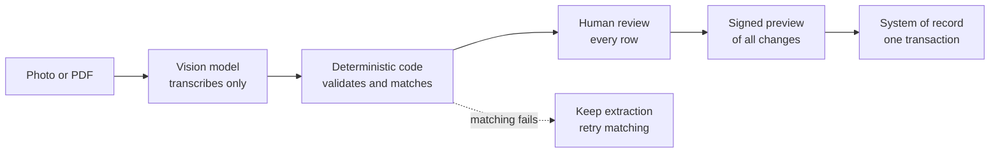

When I first benchmarked vision models on receipts, I worried about the JSON. Would the output parse? Would the model invent fields, drop keys, or wrap everything in a friendly sentence?

That turned out to be the easy part. On the public SROIE test set of 347 receipts, the best run returned valid, schema-conforming JSON for every document. Its field accuracy was 94.6%. The errors that remained weren't broken output. Most were about where a field starts and ends, and about exact normalization: a company name cut off a line too early, an address that took in a neighbouring line.

Perfectly formed and still wrong. That gap is what this post is about.

Since then I've built two extraction apps on Salesforce: a drinks-menu capture app for field sales and an expense-receipt app. Both are in test in a demo org, not in production. What follows are the design rules I ended up with. They're meant for anyone putting LLM or vision-model extraction into a business system.

## What a schema can and can't promise

Strict structured output is worth using. It removes a whole class of failures, and a good contract does more than check types:

```json
{
  "type": "object",
  "additionalProperties": false,
  "required": ["grossAmount", "currency", "categoryCode", "sourceLines"],
  "properties": {
    "grossAmount":  { "type": ["string", "null"], "pattern": "^[0-9]+\\.[0-9]{2}$" },
    "currency":     { "type": ["string", "null"], "enum": ["EUR", "CHF", null] },
    "categoryCode": { "type": ["string", "null"], "enum": ["HOTEL", "MEALS", "TRAVEL", null] },
    "sourceLines":  { "type": "array", "items": { "type": "string" } }
  }
}
```

Closed objects reject invented fields. Missing values are an explicit `null`, not an absent key. Money is a string with exactly two decimals, so nobody has to guess what `12,50` means. Categories have to come from the allowlist the caller sent with the request.

All of that is about format. The schema can't tell you whether 12.50 belongs to the line you think it does. It can't tell you whether a model that returned five positions saw six on the page. A `null` that should have been a number is just as valid as the number.

So I treat schema validity as an entry ticket. It tells me the output is safe to process, not that it's safe to believe.

## Separate authority

The most useful decision I made was to give each part of the system one job and no more.



**The model transcribes.** It reads what is on the page and returns it in the contract. It makes no business decisions and never sees Salesforce record IDs, so it can't choose a record to update, not even by accident. Anything in its output that looks like a product identity is treated as untrusted visual data. Text on the document is data, never instructions.

**Deterministic code validates and matches.** In the expense app, code checks totals, position sums and VAT arithmetic with a EUR 0.02 tolerance. A mismatch adds a warning that the model can't suppress. Code never corrects the amount itself, because it can see that two numbers disagree but not which one is wrong. In the menu app, a deterministic matcher ranks candidates from a versioned snapshot of the product catalog. A suggestion counts as "likely" only above a fixed threshold and with a clear lead over the runner-up. The reviewer sees the top three candidates, each with its evidence. No score confirms a row on its own.

**A human reviews.** Every row is confirmed, corrected or rejected. This is where the business decision gets made, not a click-through at the end.

**The system of record writes.** Only after review, and in one transaction.

The separation also tells you what to do when something breaks. If matching fails in the menu app, the finished extraction is kept, matching is marked as failed, and the user can retry. The retry uses the saved rows without calling the model again. There's no fallback matcher that quietly produces worse suggestions. A silent fallback turns an outage into bad data, and bad data is much harder to notice than an error message.

## Ground the output in the source

Hotel invoices were the hardest documents for the receipt app. A package price can hide several services at different VAT rates. The model would return a tidy total that didn't add up from the lines behind it.

What helped was source-line grounding. The provider schema requires the model to quote the invoice lines behind each position, the VAT summary and the total, and to produce the positions before the totals. A response only validates if the model has written down where its numbers came from. Code uses that evidence for checking, and it's removed before the result reaches the business system.

The menu app applies the same idea differently. Each row keeps its raw text and the printed price as evidence. The printed price wins, and the app doesn't infer a currency or decimal convention. A row with a missing price or an ambiguity is marked for review. The client can never mark a row as verified by itself.

Two cautions here. First, a prompt instruction isn't a guarantee. When an invoice has more than 20 priced lines, I ask the receipt model to return an empty list plus a warning rather than silently merging lines. But the validator can't count the lines on the page, so I document that as an instruction, not as a checked rule. Second, asking the same model whether its extraction is complete is a useful processing gate. It isn't an independent measure of accuracy.

## Make review and apply safe

Review only helps if what the user approved is exactly what gets written.

In the menu app, the server computes a preview of every change Apply would make and signs it. Apply runs only if the preview the user saw is still current. If a decision changes after that, the user has to look at a new preview. This closes a quiet gap: someone approves a screen, edits a row, and the old approval ends up covering new data.

The guard around the write looks roughly like this:

```python
def apply(extraction_id, preview_signature):
    extraction = lock(extraction_id)            # serialize concurrent applies
    if extraction.applied:
        return extraction.apply_result          # idempotent: no second write

    require_access(current_user, extraction.parent)
    require(extraction.parent.is_editable)
    require(extraction.matching_status == "COMPLETED")
    require(all(row.decision in ("CONFIRMED", "REJECTED") for row in extraction.rows))

    preview = build_preview(extraction.reviewed_decisions)
    if sign(preview) != preview_signature:
        raise Conflict("Decisions changed. Review the new preview.")

    with transaction():                         # all records or none
        result = write_records(preview)
        extraction.mark_applied(result)
    return result
```

A few properties matter more than the exact code:

- **Idempotency at both ends.** Submitting the same document twice resolves to the same job. Applying twice returns the first result instead of writing again. Each line item gets a stable key, so a retry can't duplicate it.
- **Revalidate at write time.** Lock the records, then check permissions, the parent record's state and the values again. Things may have changed since the extraction ran.
- **One transaction.** All business records are written together or not at all.
- **Fail closed.** Pending or failed matching blocks Apply. Optional integrations such as callbacks stay off unless they're explicitly configured.

## Measure with the right evidence

Public benchmarks were the right tool for choosing a model. They're a weak tool for knowing whether the product works.

The hard cases, like German hotel invoices with mixed VAT rates, never showed up in SROIE. They only appeared in real documents. I had drafted labels for over a hundred German receipts, but only a handful had been reviewed, so I never had a locked holdout set. Without one, every prompt change gets measured against whatever documents happen to be on hand.

The second trap is comparing results that only look comparable. In my menu benchmark, the best run on a focused 25-page failure set reached a combined F1 of 0.7691. The best run on the full 50-document set reached 0.7665. It's tempting to read the first number as an improvement on the second. It isn't. The smaller set was chosen precisely because those pages were hard, so the two numbers answer different questions.

So I keep the kinds of evidence apart:

- extraction quality on a fixed corpus with the same source preparation;
- matching quality, replayed on saved rows without another model call;
- latency, with the measurement boundary written down;
- end-to-end acceptance in a named environment.

A successful demo is evidence for that demo. Broader reliability needs repeated runs on the same locked set.

## Where this leaves me

None of this makes the model less important. A better model means less work for reviewers. But in a CRM, the model's output is a proposal. The design job is to keep it a proposal until a person has checked it.

If you want to see how these rules play out in the two apps, including the architecture and the benchmark numbers, I've written that up in [the case study](/work/document-ai-field-sales/).

## Design checklist

- Use a strict schema with closed objects, explicit nulls and allowlists. Treat validity as an entry ticket, not as proof.
- Let the model transcribe and nothing else. Keep record IDs and business decisions out of the prompt.
- Check arithmetic and consistency in code. Flag mismatches; never auto-correct them.
- Require source evidence for extracted values, and be explicit about which rules are prompt instructions and which are checked.
- Make matching deterministic and explainable: thresholds, a required lead, top candidates with evidence, no auto-confirm.
- When a step fails, keep what succeeded and offer a retry. No silent fallback.
- Tie approval to a signed preview, and require a new preview after any change.
- Make submit and apply idempotent. Revalidate at write time and write in one transaction.
- Build a locked test set of real documents early, and only compare runs on the same set.
