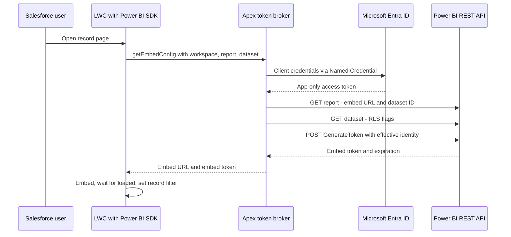

A Power BI report on a Salesforce record page sounds like a small task. Put the embed URL into an iframe, append a filter for the current record, done.

That approach fails on the two requirements that matter most. Users shouldn't have to sign in a second time. And they should only see the data they're allowed to see.

This post describes the pattern I ended up with: Apex brokers a Power BI embed token, a Lightning Web Component renders the report with the Power BI JavaScript SDK, and Power BI itself enforces row-level security (RLS). The integration is validated end to end and currently in testing, not rolled out. So read this as a guide to the design and its pitfalls, not as a production report.

## Why the iframe isn't enough

An `app.powerbi.com/reportEmbed` URL in an iframe is "embed for your organization", also called *user owns data*. The report runs under the viewer's own Power BI identity, so the browser has to sign the user in to Microsoft inside the iframe.

Even if Salesforce login is federated with the same Entra tenant, that silent sign-in depends on third-party cookies, which modern browsers increasingly block. The result is a Microsoft sign-in prompt in the middle of Salesforce, or not, depending on browser settings and extensions.

The second problem is quieter. A URL filter such as `&filter=Table/Column eq 'value'` controls what the report shows first. It doesn't control what the user is *allowed* to see. Anyone can edit the URL or clear the filter. Filters are a convenience, not authorization.

I also ruled out SAML federation, the browser flow in Salesforce External Credentials, and signing in to Power BI from the browser. Federation lets Salesforce trust Entra for login, but it doesn't issue Power BI tokens. None of these options gives you no second login *and* server-side control.

## The pattern: app owns data, Apex as token broker

Power BI's answer is "embed for your customers", or *app owns data*. A service principal, meaning an Entra app registration, talks to Power BI. Your backend requests a short-lived embed token for one report and hands only that token to the browser. Viewers never authenticate to Power BI themselves.

In Salesforce, the backend is Apex. The credentials live in an External Credential that runs the OAuth 2.0 client credentials flow against the Entra token endpoint, with the scope `https://analysis.windows.net/powerbi/api/.default`. A Named Credential, here called `PowerBI_API`, points to `https://api.powerbi.com`, and Apex calls `callout:PowerBI_API/v1.0/myorg/...`. There's no secret in the code and none in the browser.



It helps to keep two tokens apart:

- The **Entra access token** is app-only. The Named Credential fetches and refreshes it, and Apex never handles it directly.
- The **embed token** comes from Power BI's GenerateToken API. It's scoped to a report and dataset, carries the effective identity, and expires. Only this token reaches the browser, together with the embed URL.

## Let the dataset tell you what the token needs

RLS lives on the semantic model (the dataset), not on the report. Instead of hardcoding whether a report needs an identity, I read the dataset metadata before generating the token. `GET /groups/{workspaceId}/datasets/{datasetId}` returns two flags:

- `isEffectiveIdentityRequired`: the token must carry a username.
- `isEffectiveIdentityRolesRequired`: it must carry a role as well.

Together they select one of three request shapes: no identity, username only, or username plus role. The decision comes from Power BI, not from page configuration that might be out of date.

```apex
Map<String, Object> dataset = getJson('/groups/' + workspaceId + '/datasets/' + datasetId);
Boolean identityRequired = dataset.get('isEffectiveIdentityRequired') == true;
Boolean rolesRequired    = dataset.get('isEffectiveIdentityRolesRequired') == true;

Map<String, Object> body = new Map<String, Object>{
    'reports'  => new List<Object>{ new Map<String, Object>{ 'id' => reportId } },
    'datasets' => new List<Object>{ new Map<String, Object>{ 'id' => datasetId } }
};

if (identityRequired) {
    String username = currentUserEmail();
    if (String.isBlank(username)) {
        throw new AuraHandledException('Dataset requires an effective identity, but the user has none.');
    }
    Map<String, Object> identity = new Map<String, Object>{
        'username' => username,
        'datasets' => new List<String>{ datasetId }
    };
    if (rolesRequired) {
        String role = resolvePowerBiRole(); // explicit allow-list, null if nothing matches
        if (role == null) {
            throw new AuraHandledException('No supported Power BI role for this user.');
        }
        identity.put('roles', new List<String>{ role });
    }
    body.put('identities', new List<Object>{ identity });
}
```

With both flags set, the request to `POST /v1.0/myorg/GenerateToken` looks like this:

```json
{
  "reports":  [{ "id": "<reportId>" }],
  "datasets": [{ "id": "<datasetId>" }],
  "identities": [
    {
      "username": "<effective user>",
      "roles": ["<model role>"],
      "datasets": ["<datasetId>"]
    }
  ]
}
```

## Effective identity and roles, failing closed

Why not let the service principal be the RLS user? Because a service principal can't be a member of an RLS role. The backend authenticates as itself and states, in the token request, which business user the report is for. That's the effective identity.

For the username, I use the current Salesforce user's email, trimmed. That only works if the RLS rules in the model compare `USERPRINCIPALNAME()` against the same value. Verify that with whoever owns the model. It's easy to assume and hard to notice when it's wrong. If email and the model's key might diverge, a dedicated user field for the Power BI principal is the more robust choice.

When roles are required, Apex derives the Power BI role from the user's Salesforce role through an explicit allow-list: known role-name suffixes map to specific model roles, and everything else maps to nothing. A Salesforce role name doesn't prove that the model has a matching role, so the mapping has to be maintained together with the model.

What matters most is what happens when inputs are missing. If the dataset requires an identity and the user has no email, or requires a role and none can be derived, Apex throws and never requests a token. No token, no report.

The tempting alternative is a default role so the report always renders. That turns every gap in the mapping into a data leak.

## Check that report and dataset belong together

The component receives workspace, report, and dataset IDs from page configuration. Before anything else, Apex calls `GET /groups/{workspaceId}/reports/{reportId}`. The response gives me two things:

- the official `embedUrl`, which I use instead of a pasted URL, so configuration can't drift;
- the `datasetId` the report is actually bound to.

```apex
Map<String, Object> report = getJson('/groups/' + workspaceId + '/reports/' + reportId);
String embedUrl = (String) report.get('embedUrl');
if (String.isBlank(embedUrl)) {
    throw new AuraHandledException('Power BI returned no embed URL for this report.');
}
if (!datasetId.equalsIgnoreCase((String) report.get('datasetId'))) {
    throw new AuraHandledException('Report is bound to a different dataset than configured.');
}
```

The RLS flags and the identity in the token refer to the configured dataset. If the report is rebound to another model, or an admin enters the wrong ID, the security decision would be made against the wrong model. So Apex stops.

## The Lightning component

The component's job is small: load the SDK, call Apex, embed, filter.

- **SDK as Static Resource.** I load `powerbi.js` from Microsoft's `powerbi-client` package with `loadScript`. Cache control is `Public`, because it's a shared library, not user data.
- **Manual DOM container.** The SDK manipulates its container directly, so the target `div` gets `lwc:dom="manual"`.
- **Embed once.** Embedding starts in `renderedCallback()`, when the container exists, behind guard flags so re-renders don't embed twice.
- **Configurable.** Workspace, report, dataset, filter table, and filter column are App Builder properties, so admins can reuse the component for other reports without code changes.

```js
const report = powerbi.embed(container, {
    type: 'report',
    id: this.reportId,
    embedUrl: config.embedUrl,
    accessToken: config.embedToken,
    tokenType: models.TokenType.Embed,
    settings: { panes: { filters: { visible: false } } }
});

report.on('loaded', async () => {
    await report.setFilters([{
        $schema: 'http://powerbi.com/product/schema#basic',
        target: { table: this.filterTable, column: this.filterColumn },
        operator: 'In',
        values: [this.recordId],
        filterType: models.FilterType.Basic
    }]);
});
```

The record filter is UX, not security. It narrows the report to the customer on the page. RLS decides what the user may see at all. If the filter fails, the user sees more of *their own* data, not someone else's.

## Pitfalls I actually hit

**It works, then stops until someone re-saves the same secret.** After a while, callouts started failing. Re-pasting the unchanged client secret into the External Credential fixed it, temporarily. The secret wasn't expired. Power BI can signal an expired access token with `403`, while Salesforce by default only refreshes on `401`. The fix: set *Additional Status Codes for Token Refresh* on the External Credential to `401,403`.

**`401 Unauthorized` with working authentication.** `GET /groups` succeeded, so the credentials were fine. Calls against a workspace ID I had copied from another context returned `401`, because the service principal had no access to that workspace. Treat the IDs the service principal sees in its own `/groups` and report listings as the source of truth.

**`LWC1107` on deploy.** A public property named `datasetId` fails with `Properties starting with "data" are reserved attributes`. I renamed it to `pbiDatasetId` and mapped it explicitly: `datasetId: this.pbiDatasetId`.

**Filters before the report is ready.** `embed()` returns a report object immediately, but the report hasn't loaded yet. Calling `setFilters()` at that point is unreliable. Apply filters in the `loaded` handler.

**Opaque errors while debugging.** In Execute Anonymous, an `AuraHandledException` may only show "Script-thrown exception". That is why the controller now writes structured debug logs at each step: report lookup, dataset flags, RLS decision, token request. It never logs the token itself.

## Checklist

**Microsoft Entra ID**

- Single-tenant app registration with a client secret, or a certificate for production.
- Service principal in a dedicated security group.

**Power BI**

- Workspace on a capacity that supports embedding (A, EM, P, or F SKU).
- Tenant settings *Embed content in apps* and *Allow service principals to use Power BI APIs*, both scoped to the security group.
- Workspace access for the group.
- RLS roles on the semantic model, and clarity about which value `USERPRINCIPALNAME()` is compared against.

**Salesforce**

- External Credential: OAuth 2.0, client credentials with client secret, Entra token endpoint, Power BI scope, credentials passed in the request body, refresh status codes `401,403`.
- Principal with client ID and secret, and a permission set granting *External Credential Principal Access*, assigned to the users who open the page.
- Named Credential to `https://api.powerbi.com` that generates the authorization header.
- CSP Trusted Sites for the Power BI domains, at least `app.powerbi.com` and `api.powerbi.com`.
- `powerbi.js` as a public Static Resource.
- Test with one user per role, plus one user without a mappable role, who should get an error instead of a report.

Embedding the report was the easy part. Most of the work was identity: who authenticates, on whose behalf, and what happens when that isn't clear. I describe the project itself in a [case study](/work/power-bi-in-salesforce/).
