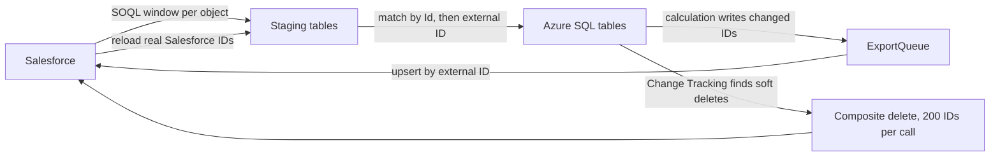

When I sync Salesforce with Azure SQL through Azure Data Factory, the copy activity is rarely the hard part. The hard part is knowing what has already happened. Which Salesforce changes are already in SQL? Which calculated results have reached Salesforce? Which SQL row is which Salesforce record?

Each of these questions needs its own progress marker. In the round trips I've built, there were four:

| Marker | Question it answers | Where it lives |
| --- | --- | --- |
| Watermark on `SystemModstamp` | Which Salesforce changes have I loaded? | Control table, one row per object |
| Outbox queue | What do I still have to send to Salesforce? | Queue table in SQL |
| Change Tracking version | Up to which database change have I processed? | Sync version table, one row per table |
| External ID | Which SQL row is which Salesforce record? | A field on both sides |

Most of the pitfalls I documented came from asking one marker a question that belongs to another. A Change Tracking version can't tell you whether a delete reached Salesforce. An external ID is not an ID you can delete by.



## Inbound: one watermark per object

A control table holds one row per Salesforce object: the object name, the SQL target table, whether deleted records are included, and the last successful watermark.

For each object, the pipeline captures the upper bound once, before it builds the query, so the window stays fixed however long the copy takes. The query filters on `SystemModstamp`, which Salesforce indexes and updates on every change, including changes made by automated processes:

```sql
SELECT Id, External_Id__c, Name, Amount__c, IsDeleted, SystemModstamp
FROM Item__c
WHERE SystemModstamp >= 2026-10-28T05:55:00Z
  AND SystemModstamp <  2026-10-29T06:00:00Z
```

The interval is half-open: `>=` on the lower bound, `<` on the upper. A record stamped exactly on the boundary belongs to exactly one window.

In the ADF pipelines I built, each window starts exactly at the last watermark. For the next iteration I've designed a small overlap: start five minutes before the last watermark. A record can become visible to queries after a run has already passed its timestamp, and the upper bound comes from the pipeline's clock, not Salesforce's. With the overlap, every change is loaded at least once, and some twice. That is only safe if loading the same row twice changes nothing, which is the next step's job.

The watermark moves to the captured upper bound only after the data has been applied in SQL. A failed run retries the same window.

If you mirror deletes, include deleted records in the query (`queryAll`, or the include-deleted option in the ADF Salesforce source). Salesforce only returns them while they're in the recycle bin, so an occasional comparison of IDs between the two systems is still worth having.

## Staging first, then an upsert that knows two keys

The copy activity only inserts into a staging table. A stored procedure then merges staging into the target in a fixed order:

1. Deduplicate staging by `Id`, keeping the row with the latest `SystemModstamp`. This absorbs the overlap.
2. Update target rows that match by `Id`.
3. Update target rows that match by external ID, **including the `Id` column**.
4. Insert only rows whose `Id` and external ID both don't exist yet.

```sql
-- step 3: adopt rows created in SQL and take over the real Salesforce Id
UPDATE t
SET    t.Id = s.Id, t.Name = s.Name, t.Amount__c = s.Amount__c
FROM   dbo.Item AS t
JOIN   #Deduped AS s ON t.External_Id__c = s.External_Id__c
WHERE  ISNULL(t.Protection, 0) = 0;

-- step 4: insert only if neither key is known
INSERT INTO dbo.Item (Id, External_Id__c, Name, Amount__c)
SELECT s.Id, s.External_Id__c, s.Name, s.Amount__c
FROM   #Deduped AS s
WHERE  NOT EXISTS (SELECT 1 FROM dbo.Item t WHERE t.Id = s.Id)
  AND  NOT EXISTS (SELECT 1 FROM dbo.Item t WHERE t.External_Id__c = s.External_Id__c);
```

Step 3 is what lets a record created in SQL with a placeholder ID pick up its real Salesforce ID later. Updating first also keeps the insert from hitting a primary key violation. Rows flagged with `Protection = 1` are skipped by every update, so someone can deliberately freeze a row without it being overwritten on the next load.

One limit: deduplicating by `Id` won't catch two staging rows with different IDs but the same external ID. If your source can produce that, deduplicate on the external ID as well.

## Outbound: let a queue decide what to export

An early version of one export read every row and upserted all of it, which re-sends unchanged records and leaves no record of what is still outstanding. The replacement was an outbox: the calculation writes the IDs of the rows it changed into a queue table, in the same transaction as the results.

```sql
CREATE TABLE dbo.ExportQueue (
    QueueId     bigint IDENTITY PRIMARY KEY,
    EntityType  varchar(50)      NOT NULL,
    Id          nvarchar(18)     NOT NULL,
    ChangeType  char(1)          NOT NULL,  -- I or U
    RunId       uniqueidentifier NOT NULL,
    ExportedUtc datetime2        NULL
);
```

Each export branch joins pending queue rows to the current table, skips soft-deleted rows, and upserts to Salesforce by external ID. Afterwards it sets `ExportedUtc`.

The detail I'd change first is the acknowledgement. In my implementation, marking set `ExportedUtc` on *all* pending rows of an entity type. With one pipeline run at a time, that holds. But concurrency 1 doesn't stop another producer from adding a row between the copy and the mark, and that row would be marked without having been sent. Acknowledging only the rows of the captured `RunId` closes that gap.

## Change Tracking: progress, with a guard

Change Tracking is enabled on the outbound tables, and a sync version table stores the last processed version per pipeline and table. At the start of a branch, a lookup reads three values: the stored version, the current version and the minimum valid version.

```sql
DECLARE @last bigint = (SELECT last_version FROM dbo.SyncVersion
                        WHERE table_name = 'dbo.Item');
DECLARE @min  bigint = CHANGE_TRACKING_MIN_VALID_VERSION(OBJECT_ID('dbo.Item'));

SELECT CASE WHEN ISNULL(@last, 0) < ISNULL(@min, 0)
            THEN @min ELSE ISNULL(@last, 0) END AS from_version,
       CHANGE_TRACKING_CURRENT_VERSION()      AS to_version;
```

If the stored version is older than the retention boundary, the guard starts from the minimum valid version instead. That keeps the pipeline running, but the changes that aged out are gone. Treat a triggered guard as a signal to reconcile, not as a fix.

The current version is captured *before* the export, and it is written back only after success: copy, then mark the queue, then advance the version.

“After success” has to include every step that reads the same window. In one pipeline, the version update for a table depended on the queue marking but not on the delete loop that used the same window. If a delete failed, the version could still advance, and the next run would never see those deletes again. Make the version update depend on all consumers of the window.

## Identity: external IDs for upserts, Salesforce IDs for deletes

Records created in SQL don't have a Salesforce ID yet. I give them a deterministic external ID built from the business key, such as `<ParentId>_<ChildId>`. A rerun produces the same key, so the upsert updates the record instead of creating a duplicate.

After the export, the pipeline reloads those objects from Salesforce and runs the merge above. Step 3 swaps the placeholder for the real ID.

Deletes work differently. The composite endpoint `DELETE /services/data/vXX.X/composite/sobjects?ids=…` accepts up to 200 **record IDs**. An external ID is an upsert key and doesn't work there. That is one more reason the reconciliation matters: until it has run, the `Id` of a row created in SQL is a value Salesforce has never seen.

```sql
WITH Deleted AS (
    SELECT t.Id,
           (ROW_NUMBER() OVER (ORDER BY t.Id) - 1) / 200 AS BatchNo
    FROM   CHANGETABLE(CHANGES dbo.Item, @from_version) AS ct
    JOIN   dbo.Item AS t ON t.Id = ct.Id
    WHERE  ct.SYS_CHANGE_VERSION <= @to_version
      AND  t.IsDeleted = 1
)
SELECT BatchNo, STRING_AGG(CAST(Id AS varchar(max)), ',') AS IdList
FROM   Deleted
GROUP  BY BatchNo;
```

This relies on soft deletes in SQL: the query joins back to the table to check `IsDeleted`, so a physically deleted row can't be found this way. In one pipeline, the delete call had been corrected to use `Id` while the loop's “is there another batch?” lookup still grouped by the external ID. Both queries must use the same column and the same rows.

With `allOrNone=false`, Salesforce deletes what it can and reports failures per record. A successful HTTP call doesn't mean every record is gone, so log the response.

## Operational details that cost me time

- **One run at a time.** The main pipeline runs with concurrency 1. The Azure Functions that calculate results take an application lock with `sp_getapplock`. The per-object loop runs sequentially because it shares pipeline variables.
- **Don't send audit fields back.** Including `SystemModstamp`, `LastModifiedDate`, `LastModifiedById`, `CreatedDate` and `CreatedById` in the upsert caused failures. Salesforce maintains them. The export now sends business fields only, even though SQL stamps its own audit values when it changes a row.
- **Nulls overwrite.** With ADF's `ignoreNullValues` set to false, a null in SQL clears the field in Salesforce. Decide that on purpose.
- **Parents before children.** Two parallel export branches for a parent and its child object are only safe if the parent already exists in Salesforce.
- **Permissions.** Reading `CHANGETABLE` needs `VIEW CHANGE TRACKING` on the table in addition to `SELECT`. Truncating a staging table needs `ALTER`, and a generic merge that reads column metadata needs `VIEW DEFINITION`. A missing grant can show up as “Cannot find the object … because it does not exist or you do not have permissions.”
- **Honest logs.** Pass the real error text into your run log, and remember that the copy's row count means *staged* rows, not rows changed in the target.

I used these patterns in two projects that I've written up as case studies: [Perfect Store scoring](/work/perfect-store-scoring/) and [sales targets](/work/sales-targets-azure/).

## Checklist

- One watermark per object, upper bound captured once per run, half-open interval on `SystemModstamp`.
- Optional overlap on the lower bound, only if applying a row twice changes nothing.
- Staging first; merge by `Id`, then by external ID, then insert if neither key exists.
- Protected rows are excluded from updates.
- Outbound selection comes from an outbox queue written in the same transaction as the results.
- Acknowledge exactly the exported rows, ideally by run ID.
- Capture the Change Tracking version before exporting; check it against the minimum valid version.
- Advance the version only after every step that uses its window has succeeded, deletes included.
- Deterministic external IDs for records created in SQL, real Salesforce IDs reconciled back.
- Deletes in batches of up to 200 real record IDs; check per-record results.
- One run at a time.
- No audit fields in the outbound mapping; nulls handled deliberately.
- Grants for Change Tracking and staging checked before the first run.
