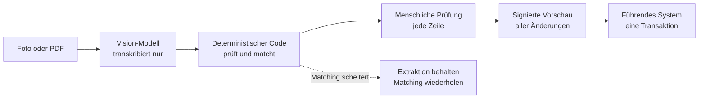

Als ich zum ersten Mal Vision-Modelle auf Kassenbelegen getestet habe, hat mich vor allem das JSON beschäftigt. Lässt sich die Ausgabe parsen? Erfindet das Modell Felder, lässt Schlüssel weg oder verpackt alles in einen freundlichen Satz?

Das war der einfache Teil. Auf dem öffentlichen SROIE-Testset mit 347 Belegen lieferte der beste Lauf für jedes Dokument gültiges, schemakonformes JSON. Die Feldgenauigkeit lag bei 94,6 %. Die verbleibenden Fehler waren keine kaputten Ausgaben. Meist ging es darum, wo ein Feld beginnt und endet, und um die exakte Normalisierung: ein Firmenname, der eine Zeile zu früh aufhört, eine Adresse, die die Nachbarzeile mitnimmt.

Formal einwandfrei und trotzdem falsch. Um genau diese Lücke geht es in diesem Beitrag.

Inzwischen habe ich zwei Extraktions-Apps auf Salesforce gebaut: eine App zur Erfassung von Getränkekarten für den Außendienst und eine App für Spesenbelege. Beide laufen im Test in einer Demo-Org, nicht in Produktion. Im Folgenden stehen die Designregeln, bei denen ich gelandet bin. Sie richten sich an alle, die LLM- oder Vision-Extraktion in ein Geschäftssystem bringen wollen.

## Was ein Schema verspricht – und was nicht

Strikte strukturierte Ausgaben lohnen sich. Sie beseitigen eine ganze Fehlerklasse, und ein guter Vertrag prüft mehr als nur Datentypen:

```json
{
  "type": "object",
  "additionalProperties": false,
  "required": ["grossAmount", "currency", "categoryCode", "sourceLines"],
  "properties": {
    "grossAmount":  { "type": ["string", "null"], "pattern": "^[0-9]+\\.[0-9]{2}$" },
    "currency":     { "type": ["string", "null"], "enum": ["EUR", "CHF", null] },
    "categoryCode": { "type": ["string", "null"], "enum": ["HOTEL", "MEALS", "TRAVEL", null] },
    "sourceLines":  { "type": "array", "items": { "type": "string" } }
  }
}
```

Geschlossene Objekte weisen erfundene Felder zurück. Fehlende Werte sind ein explizites `null` statt eines fehlenden Schlüssels. Geldbeträge sind Strings mit genau zwei Nachkommastellen, sodass niemand raten muss, was `12,50` bedeutet. Kategorien müssen aus der Liste stammen, die der Aufrufer mit der Anfrage mitschickt.

All das betrifft das Format. Das Schema kann Ihnen nicht sagen, ob 12,50 zu der Zeile gehört, an die Sie denken. Es kann nicht sagen, ob ein Modell, das fünf Positionen zurückgibt, auf der Seite sechs gesehen hat. Ein `null`, das eigentlich eine Zahl hätte sein sollen, ist genauso gültig wie die Zahl selbst.

Schema-Validität ist für mich deshalb eine Eintrittskarte. Sie sagt mir, dass ich die Ausgabe gefahrlos verarbeiten kann – nicht, dass ich ihr glauben kann.

## Zuständigkeiten trennen

Die nützlichste Entscheidung war, jedem Teil des Systems genau eine Aufgabe zu geben und keine weitere.



**Das Modell transkribiert.** Es liest, was auf der Seite steht, und gibt es im vereinbarten Format zurück. Es trifft keine fachlichen Entscheidungen und sieht nie Salesforce-Record-IDs. Es kann also keinen Datensatz zum Aktualisieren auswählen, nicht einmal versehentlich. Alles in seiner Ausgabe, was wie eine Produktidentität aussieht, gilt als unbestätigte visuelle Information. Text auf dem Dokument ist Daten, niemals eine Anweisung.

**Deterministischer Code prüft und matcht.** In der Spesen-App prüft Code Summen, Positionssummen und Mehrwertsteuer mit einer Toleranz von 0,02 EUR. Eine Abweichung erzeugt eine Warnung, die das Modell nicht unterdrücken kann. Den Betrag selbst korrigiert der Code nie: Er erkennt zwar, dass zwei Zahlen nicht zusammenpassen, aber nicht, welche davon falsch ist. In der Getränkekarten-App bewertet ein deterministischer Matcher Kandidaten aus einem versionierten Snapshot des Produktkatalogs. Ein Vorschlag gilt nur dann als „wahrscheinlich“, wenn er über einem festen Schwellenwert liegt und klar vor dem Zweitplatzierten. Die prüfende Person sieht die drei besten Kandidaten, jeweils mit ihrer Begründung. Kein Score bestätigt eine Zeile von selbst.

**Ein Mensch prüft.** Jede Zeile wird bestätigt, korrigiert oder verworfen. Hier fällt die fachliche Entscheidung – das ist kein Durchklicken am Ende.

**Das führende System schreibt.** Erst nach der Prüfung und in einer einzigen Transaktion.

Die Trennung zeigt auch, was zu tun ist, wenn etwas schiefgeht. Scheitert in der Getränkekarten-App das Matching, bleibt die fertige Extraktion erhalten, das Matching wird als fehlgeschlagen markiert, und die Nutzerin oder der Nutzer kann es erneut anstoßen. Der neue Versuch nutzt die gespeicherten Zeilen, ohne das Modell noch einmal aufzurufen. Es gibt keinen Ersatz-Matcher, der stillschweigend schlechtere Vorschläge liefert. Ein stiller Fallback macht aus einem Ausfall fehlerhafte Daten – und die fallen viel später auf als eine Fehlermeldung.

## Die Ausgabe in der Quelle verankern

Hotelrechnungen waren für die Spesen-App die schwierigsten Dokumente. Hinter einem Pauschalpreis können mehrere Leistungen mit unterschiedlichen Mehrwertsteuersätzen stecken. Das Modell lieferte dann eine saubere Summe, die sich aus den zugrunde liegenden Zeilen nicht ergab.

Geholfen hat Source-Line-Grounding. Das Provider-Schema verlangt, dass das Modell die Rechnungszeilen hinter jeder Position, hinter der Mehrwertsteuerübersicht und hinter der Gesamtsumme zitiert – und die Positionen vor den Summen erzeugt. Eine Antwort ist nur gültig, wenn das Modell aufgeschrieben hat, woher seine Zahlen stammen. Code nutzt diese Belege zur Prüfung; bevor das Ergebnis im Geschäftssystem ankommt, werden sie entfernt.

Die Getränkekarten-App setzt dieselbe Idee anders um. Jede Zeile behält ihren Rohtext und den gedruckten Preis als Beleg. Der gedruckte Preis hat Vorrang, und die App leitet weder Währung noch Dezimalschreibweise ab. Eine Zeile ohne Preis oder mit einer Mehrdeutigkeit wird zur Prüfung markiert. Der Client kann eine Zeile nie selbst als verifiziert kennzeichnen.

Zwei Einschränkungen. Erstens: Eine Anweisung im Prompt ist keine Garantie. Hat eine Rechnung mehr als 20 bepreiste Zeilen, bitte ich das Modell, statt stillschweigend Zeilen zusammenzufassen, eine leere Liste und eine Warnung zurückzugeben. Der Validator kann die Zeilen auf der Seite aber nicht zählen. Ich dokumentiere das deshalb als Anweisung, nicht als geprüfte Regel. Zweitens: Dasselbe Modell zu fragen, ob seine Extraktion vollständig ist, ist ein nützliches Verarbeitungs-Gate. Ein unabhängiges Maß für Genauigkeit ist es nicht.

## Prüfen und Übernehmen absichern

Die Prüfung hilft nur, wenn genau das geschrieben wird, was freigegeben wurde.

In der Getränkekarten-App berechnet der Server eine Vorschau aller Änderungen, die das Übernehmen auslösen würde, und signiert sie. Geschrieben wird nur, wenn die gesehene Vorschau noch aktuell ist. Ändert sich danach eine Entscheidung, muss eine neue Vorschau angesehen werden. Damit schließt sich eine unauffällige Lücke: Jemand gibt einen Bildschirm frei, ändert danach eine Zeile, und die alte Freigabe deckt plötzlich neue Daten ab.

Die Absicherung rund um den Schreibvorgang sieht ungefähr so aus:

```python
def apply(extraction_id, preview_signature):
    extraction = lock(extraction_id)            # serialize concurrent applies
    if extraction.applied:
        return extraction.apply_result          # idempotent: no second write

    require_access(current_user, extraction.parent)
    require(extraction.parent.is_editable)
    require(extraction.matching_status == "COMPLETED")
    require(all(row.decision in ("CONFIRMED", "REJECTED") for row in extraction.rows))

    preview = build_preview(extraction.reviewed_decisions)
    if sign(preview) != preview_signature:
        raise Conflict("Decisions changed. Review the new preview.")

    with transaction():                         # all records or none
        result = write_records(preview)
        extraction.mark_applied(result)
    return result
```

Einige Eigenschaften sind wichtiger als der genaue Code:

- **Idempotenz an beiden Enden.** Wird dasselbe Dokument zweimal eingereicht, landet es beim selben Job. Ein zweites Übernehmen liefert das erste Ergebnis zurück, statt erneut zu schreiben. Jede Position erhält einen stabilen Schlüssel, damit ein Retry sie nicht verdoppelt.
- **Beim Schreiben neu validieren.** Datensätze sperren, dann Berechtigungen, den Zustand des übergeordneten Datensatzes und die Werte erneut prüfen. Seit der Extraktion kann sich einiges geändert haben.
- **Eine Transaktion.** Alle fachlichen Datensätze werden gemeinsam geschrieben oder gar nicht.
- **Im Zweifel geschlossen.** Ein ausstehendes oder fehlgeschlagenes Matching blockiert das Übernehmen. Optionale Integrationen wie Callbacks bleiben aus, solange sie nicht ausdrücklich konfiguriert sind.

## Mit der richtigen Evidenz messen

Öffentliche Benchmarks waren das richtige Werkzeug, um ein Modell auszuwählen. Um zu wissen, ob das Produkt funktioniert, taugen sie wenig.

Die schwierigen Fälle, etwa deutsche Hotelrechnungen mit gemischten Steuersätzen, kamen in SROIE nie vor. Sie tauchten erst in echten Dokumenten auf. Ich hatte Labels für über hundert deutsche Belege angelegt, aber nur eine Handvoll davon war geprüft. Ein gesperrtes Holdout-Set hatte ich deshalb nie. Ohne ein solches Set misst man jede Prompt-Änderung an den Dokumenten, die gerade zur Hand sind.

Die zweite Falle: Ergebnisse vergleichen, die nur vergleichbar aussehen. In meinem Getränkekarten-Benchmark erreichte der beste Lauf auf einem fokussierten Fehler-Set von 25 Seiten einen kombinierten F1-Wert von 0,7691. Der beste Lauf auf dem vollständigen Set mit 50 Dokumenten kam auf 0,7665. Es liegt nahe, die erste Zahl als Verbesserung gegenüber der zweiten zu lesen. Das ist sie nicht. Das kleinere Set wurde gerade deshalb ausgewählt, weil diese Seiten schwierig waren – die beiden Zahlen beantworten unterschiedliche Fragen.

Ich halte die Arten von Evidenz deshalb auseinander:

- Extraktionsqualität auf einem festen Korpus mit gleicher Aufbereitung der Quellen;
- Matching-Qualität, nachgespielt auf gespeicherten Zeilen ohne weiteren Modellaufruf;
- Latenz, mit klar dokumentierter Messgrenze;
- End-to-End-Abnahme in einer benannten Umgebung.

Eine erfolgreiche Demo ist ein Beleg für genau diese Demo. Für belastbare Zuverlässigkeit braucht es wiederholte Läufe auf demselben gesperrten Set.

## Was bleibt

Nichts davon macht das Modell unwichtiger. Ein besseres Modell bedeutet weniger Arbeit für die Prüfenden. Aber in einem CRM ist die Ausgabe des Modells ein Vorschlag. Die Designaufgabe besteht darin, dass sie ein Vorschlag bleibt, bis ein Mensch sie geprüft hat.

Wie sich diese Regeln in den beiden Apps konkret auswirken, inklusive Architektur und Benchmark-Zahlen, beschreibe ich in [der Fallstudie](/de/work/document-ai-field-sales/).

## Design-Checkliste

- Verwenden Sie ein striktes Schema mit geschlossenen Objekten, expliziten `null`-Werten und festen Wertelisten. Behandeln Sie Validität als Eintrittskarte, nicht als Beweis.
- Lassen Sie das Modell nur transkribieren. Halten Sie Record-IDs und fachliche Entscheidungen aus dem Prompt heraus.
- Prüfen Sie Rechenwerte und Konsistenz im Code. Markieren Sie Abweichungen, korrigieren Sie sie nie automatisch.
- Verlangen Sie Quellbelege für extrahierte Werte, und halten Sie fest, welche Regeln Prompt-Anweisungen sind und welche tatsächlich geprüft werden.
- Gestalten Sie das Matching deterministisch und nachvollziehbar: Schwellenwerte, ein Mindestabstand, die besten Kandidaten mit Begründung, keine automatische Bestätigung.
- Wenn ein Schritt scheitert, behalten Sie das bereits Erreichte und bieten Sie einen Retry an. Kein stiller Fallback.
- Binden Sie die Freigabe an eine signierte Vorschau, und verlangen Sie nach jeder Änderung eine neue.
- Machen Sie Einreichen und Übernehmen idempotent. Validieren Sie beim Schreiben erneut und schreiben Sie in einer Transaktion.
- Bauen Sie früh ein gesperrtes Testset aus echten Dokumenten auf, und vergleichen Sie Läufe nur auf demselben Set.
