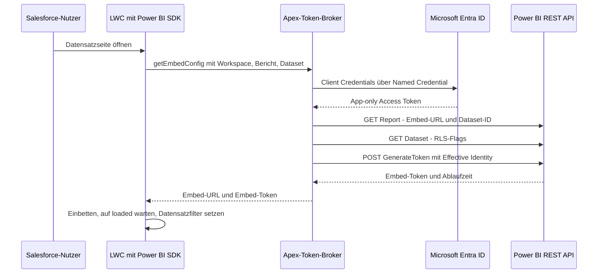

Ein Power-BI-Bericht auf einer Salesforce-Datensatzseite klingt nach einer kleinen Aufgabe. Embed-URL in einen iframe, Filter für den aktuellen Datensatz anhängen, fertig.

Genau dieser Weg scheitert an den beiden Anforderungen, auf die es am meisten ankommt: Niemand soll sich ein zweites Mal anmelden müssen. Und jede Person soll nur die Daten sehen, die sie sehen darf.

In diesem Beitrag beschreibe ich das Muster, bei dem ich gelandet bin: Apex vermittelt ein Power-BI-Embed-Token, eine Lightning Web Component rendert den Bericht mit dem Power BI JavaScript SDK, und Power BI selbst setzt die Row-Level Security (RLS) durch. Die Integration ist durchgängig validiert und befindet sich im Test, nicht im produktiven Rollout. Lesen Sie den Text also als Leitfaden für Design und Stolperfallen, nicht als Erfahrungsbericht aus dem Betrieb.

## Warum der iframe nicht reicht

Eine `app.powerbi.com/reportEmbed`-URL im iframe ist „Embed for your organization“, auch *User Owns Data* genannt. Der Bericht läuft unter der eigenen Power-BI-Identität der Betrachtenden, also muss der Browser sie innerhalb des iframes bei Microsoft anmelden.

Selbst wenn der Salesforce-Login mit demselben Entra-Tenant föderiert ist, hängt diese stille Anmeldung an Drittanbieter-Cookies – und die blockieren moderne Browser zunehmend. Das Ergebnis ist eine Microsoft-Anmeldemaske mitten in Salesforce. Oder auch nicht, je nach Browsereinstellungen und Erweiterungen.

Das zweite Problem ist leiser. Ein URL-Filter wie `&filter=Table/Column eq 'value'` steuert, was der Bericht zuerst anzeigt. Er steuert nicht, was die Person sehen *darf*. Die URL lässt sich bearbeiten, der Filter entfernen. Filter sind Komfort, keine Berechtigung.

Außerdem habe ich SAML-Föderation, den Browser-Flow der Salesforce External Credentials und die Anmeldung bei Power BI aus dem Browser heraus ausgeschlossen. Föderation sorgt dafür, dass Salesforce Entra beim Login vertraut – Power-BI-Tokens stellt sie nicht aus. Keine dieser Varianten bietet beides: keine zweite Anmeldung *und* serverseitige Kontrolle.

## Das Muster: App Owns Data, Apex als Token-Broker

Die Antwort von Power BI heißt „Embed for your customers“ oder *App Owns Data*. Ein Service Principal, also eine Entra-App-Registrierung, spricht mit Power BI. Ihr Backend fordert ein kurzlebiges Embed-Token für genau einen Bericht an und gibt nur dieses Token an den Browser weiter. Die Betrachtenden authentifizieren sich nie selbst bei Power BI.

In Salesforce ist das Backend Apex. Die Zugangsdaten liegen in einer External Credential, die den OAuth-2.0-Client-Credentials-Flow gegen den Entra-Token-Endpunkt ausführt, mit dem Scope `https://analysis.windows.net/powerbi/api/.default`. Eine Named Credential, hier `PowerBI_API`, zeigt auf `https://api.powerbi.com`, und Apex ruft `callout:PowerBI_API/v1.0/myorg/...` auf. Kein Secret im Code, keines im Browser.



Es hilft, zwei Tokens sauber zu trennen:

- Das **Entra Access Token** ist app-only. Die Named Credential holt und erneuert es; Apex fasst es nie direkt an.
- Das **Embed-Token** stammt aus der GenerateToken-API von Power BI. Es gilt für einen Bericht und ein Dataset, trägt die Effective Identity und läuft ab. Nur dieses Token erreicht den Browser, zusammen mit der Embed-URL.

## Das Dataset sagen lassen, was das Token braucht

RLS lebt im semantischen Modell (dem Dataset), nicht im Bericht. Statt fest zu verdrahten, ob ein Bericht eine Identität braucht, lese ich vor der Token-Erzeugung die Dataset-Metadaten. `GET /groups/{workspaceId}/datasets/{datasetId}` liefert zwei Flags:

- `isEffectiveIdentityRequired`: Das Token muss einen Benutzernamen tragen.
- `isEffectiveIdentityRolesRequired`: Es muss zusätzlich eine Rolle tragen.

Zusammen bestimmen sie eine von drei Request-Varianten: ohne Identität, nur mit Benutzername oder mit Benutzername und Rolle. Die Entscheidung kommt von Power BI, nicht aus einer Seitenkonfiguration, die womöglich veraltet ist.

```apex
Map<String, Object> dataset = getJson('/groups/' + workspaceId + '/datasets/' + datasetId);
Boolean identityRequired = dataset.get('isEffectiveIdentityRequired') == true;
Boolean rolesRequired    = dataset.get('isEffectiveIdentityRolesRequired') == true;

Map<String, Object> body = new Map<String, Object>{
    'reports'  => new List<Object>{ new Map<String, Object>{ 'id' => reportId } },
    'datasets' => new List<Object>{ new Map<String, Object>{ 'id' => datasetId } }
};

if (identityRequired) {
    String username = currentUserEmail();
    if (String.isBlank(username)) {
        throw new AuraHandledException('Dataset requires an effective identity, but the user has none.');
    }
    Map<String, Object> identity = new Map<String, Object>{
        'username' => username,
        'datasets' => new List<String>{ datasetId }
    };
    if (rolesRequired) {
        String role = resolvePowerBiRole(); // explicit allow-list, null if nothing matches
        if (role == null) {
            throw new AuraHandledException('No supported Power BI role for this user.');
        }
        identity.put('roles', new List<String>{ role });
    }
    body.put('identities', new List<Object>{ identity });
}
```

Sind beide Flags gesetzt, sieht der Request an `POST /v1.0/myorg/GenerateToken` so aus:

```json
{
  "reports":  [{ "id": "<reportId>" }],
  "datasets": [{ "id": "<datasetId>" }],
  "identities": [
    {
      "username": "<effective user>",
      "roles": ["<model role>"],
      "datasets": ["<datasetId>"]
    }
  ]
}
```

## Effective Identity und Rollen – im Zweifel blockieren

Warum nicht einfach den Service Principal zum RLS-Benutzer machen? Weil ein Service Principal kein Mitglied einer RLS-Rolle sein kann. Das Backend authentifiziert sich als es selbst und gibt im Token-Request an, für welche fachliche Person der Bericht bestimmt ist. Das ist die Effective Identity.

Als Benutzernamen verwende ich die E-Mail-Adresse der in Salesforce angemeldeten Person, bereinigt um Leerzeichen am Rand. Das funktioniert nur, wenn die RLS-Regeln im Modell `USERPRINCIPALNAME()` mit genau diesem Wert vergleichen. Klären Sie das mit den Verantwortlichen für das Modell. Man setzt es leicht voraus und merkt schwer, wenn es nicht stimmt. Können E-Mail und Modellschlüssel auseinanderlaufen, ist ein eigenes Benutzerfeld für den Power-BI-Principal die robustere Wahl.

Sind Rollen gefordert, leitet Apex die Power-BI-Rolle über eine explizite Allow-List aus der Salesforce-Rolle ab: Bekannte Endungen des Rollennamens werden auf bestimmte Modellrollen abgebildet, alles andere auf nichts. Ein Salesforce-Rollenname beweist nicht, dass es im Modell eine passende Rolle gibt – das Mapping muss also gemeinsam mit dem Modell gepflegt werden.

Am wichtigsten ist, was bei fehlenden Eingaben passiert. Verlangt das Dataset eine Identität und die Person hat keine E-Mail-Adresse, oder verlangt es eine Rolle und es lässt sich keine ableiten, wirft Apex eine Exception und fordert gar kein Token an. Kein Token, kein Bericht.

Die verlockende Alternative ist eine Standardrolle, damit der Bericht immer erscheint. Damit wird jede Lücke im Mapping zum Datenleck.

## Prüfen, ob Bericht und Dataset zusammengehören

Die Komponente erhält Workspace-, Bericht- und Dataset-ID aus der Seitenkonfiguration. Als Erstes ruft Apex `GET /groups/{workspaceId}/reports/{reportId}` auf. Die Antwort liefert zwei Dinge:

- die offizielle `embedUrl`, die ich statt einer eingefügten URL verwende, damit die Konfiguration nicht auseinanderläuft;
- die `datasetId`, an die der Bericht tatsächlich gebunden ist.

```apex
Map<String, Object> report = getJson('/groups/' + workspaceId + '/reports/' + reportId);
String embedUrl = (String) report.get('embedUrl');
if (String.isBlank(embedUrl)) {
    throw new AuraHandledException('Power BI returned no embed URL for this report.');
}
if (!datasetId.equalsIgnoreCase((String) report.get('datasetId'))) {
    throw new AuraHandledException('Report is bound to a different dataset than configured.');
}
```

Die RLS-Flags und die Identität im Token beziehen sich auf das konfigurierte Dataset. Wird der Bericht an ein anderes Modell gebunden oder trägt jemand die falsche ID ein, fiele die Sicherheitsentscheidung gegen das falsche Modell. Also bricht Apex ab.

## Die Lightning-Komponente

Die Aufgabe der Komponente ist überschaubar: SDK laden, Apex aufrufen, einbetten, filtern.

- **SDK als Static Resource.** Ich lade `powerbi.js` aus Microsofts Paket `powerbi-client` per `loadScript`. Die Cache-Control steht auf `Public`, weil es sich um eine gemeinsam genutzte Bibliothek handelt, nicht um Nutzerdaten.
- **Manueller DOM-Container.** Das SDK manipuliert seinen Container direkt, deshalb bekommt das Ziel-`div` das Attribut `lwc:dom="manual"`.
- **Nur einmal einbetten.** Das Einbetten startet in `renderedCallback()`, wenn der Container existiert, abgesichert durch Guard-Flags, damit erneutes Rendern nicht doppelt einbettet.
- **Konfigurierbar.** Workspace, Bericht, Dataset, Filtertabelle und Filterspalte sind App-Builder-Eigenschaften. So können Admins die Komponente ohne Codeänderung für weitere Berichte nutzen.

```js
const report = powerbi.embed(container, {
    type: 'report',
    id: this.reportId,
    embedUrl: config.embedUrl,
    accessToken: config.embedToken,
    tokenType: models.TokenType.Embed,
    settings: { panes: { filters: { visible: false } } }
});

report.on('loaded', async () => {
    await report.setFilters([{
        $schema: 'http://powerbi.com/product/schema#basic',
        target: { table: this.filterTable, column: this.filterColumn },
        operator: 'In',
        values: [this.recordId],
        filterType: models.FilterType.Basic
    }]);
});
```

Der Datensatzfilter ist UX, keine Sicherheit. Er grenzt den Bericht auf den Kunden der aktuellen Seite ein. Was die Person überhaupt sehen darf, entscheidet RLS. Schlägt der Filter fehl, sieht sie mehr von *ihren eigenen* Daten, nicht die von anderen.

## Stolperfallen, die mir tatsächlich begegnet sind

**Es läuft – und dann nicht mehr, bis jemand dasselbe Secret neu speichert.** Nach einiger Zeit schlugen die Callouts fehl. Das unveränderte Client Secret erneut in die External Credential einzufügen half, aber nur vorübergehend. Abgelaufen war das Secret nicht. Power BI kann ein abgelaufenes Access Token mit `403` quittieren, Salesforce erneuert standardmäßig aber nur bei `401`. Die Lösung: In der External Credential unter *Additional Status Codes for Token Refresh* `401,403` eintragen.

**`401 Unauthorized` trotz funktionierender Authentifizierung.** `GET /groups` lief durch, die Zugangsdaten waren also in Ordnung. Aufrufe gegen eine Workspace-ID, die ich aus einem anderen Kontext kopiert hatte, lieferten dennoch `401` – der Service Principal hatte auf diesen Workspace keinen Zugriff. Maßgeblich sind die IDs, die der Service Principal in seinen eigenen `/groups`- und Berichtslisten sieht.

**`LWC1107` beim Deployment.** Eine öffentliche Property namens `datasetId` scheitert mit `Properties starting with "data" are reserved attributes`. Ich habe sie in `pbiDatasetId` umbenannt und explizit zugeordnet: `datasetId: this.pbiDatasetId`.

**Filter, bevor der Bericht bereit ist.** `embed()` liefert sofort ein Report-Objekt zurück, geladen ist der Bericht aber noch nicht. Ein `setFilters()` zu diesem Zeitpunkt ist unzuverlässig. Setzen Sie Filter im `loaded`-Handler.

**Undurchsichtige Fehler beim Debuggen.** In Execute Anonymous zeigt eine `AuraHandledException` unter Umständen nur „Script-thrown exception“. Deshalb schreibt der Controller inzwischen an jedem Schritt strukturierte Debug-Logs: Berichtsabfrage, Dataset-Flags, RLS-Entscheidung, Token-Request. Das Token selbst wird nie geloggt.

## Checkliste

**Microsoft Entra ID**

- Single-Tenant-App-Registrierung mit Client Secret, für die Produktion besser mit Zertifikat.
- Service Principal in einer eigenen Sicherheitsgruppe.

**Power BI**

- Workspace auf einer Kapazität, die Embedding unterstützt (A-, EM-, P- oder F-SKU).
- Tenant-Einstellungen *Embed content in apps* und *Allow service principals to use Power BI APIs*, beide auf die Sicherheitsgruppe beschränkt.
- Workspace-Zugriff für die Gruppe.
- RLS-Rollen im semantischen Modell – und Klarheit darüber, mit welchem Wert `USERPRINCIPALNAME()` verglichen wird.

**Salesforce**

- External Credential: OAuth 2.0, Client Credentials mit Client Secret, Entra-Token-Endpunkt, Power-BI-Scope, Zugangsdaten im Request-Body, Refresh-Statuscodes `401,403`.
- Principal mit Client-ID und Secret sowie ein Permission Set mit *External Credential Principal Access*, zugewiesen an alle, die die Seite öffnen.
- Named Credential auf `https://api.powerbi.com`, die den Authorization-Header erzeugt.
- CSP Trusted Sites für die Power-BI-Domains, mindestens `app.powerbi.com` und `api.powerbi.com`.
- `powerbi.js` als öffentliche Static Resource.
- Test mit je einer Person pro Rolle und einer Person ohne ableitbare Rolle – die sollte eine Fehlermeldung statt eines Berichts bekommen.

Den Bericht einzubetten war der einfache Teil. Die meiste Arbeit steckte in der Identität: Wer authentifiziert sich, in wessen Namen, und was passiert, wenn das nicht eindeutig ist? Das Projekt selbst beschreibe ich in einer [Fallstudie](/de/work/power-bi-in-salesforce/).
