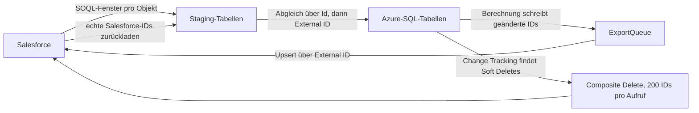

Wenn ich Salesforce über Azure Data Factory mit Azure SQL synchronisiere, ist die Copy-Aktivität selten das Schwierige. Schwierig ist, zu wissen, was bereits passiert ist. Welche Änderungen aus Salesforce sind schon in SQL? Welche berechneten Ergebnisse sind in Salesforce angekommen? Welche SQL-Zeile entspricht welchem Salesforce-Datensatz?

Jede dieser Fragen braucht ihren eigenen Fortschrittsmarker. In den Roundtrips, die ich gebaut habe, waren es vier:

| Marker | Beantwortet die Frage | Liegt in |
| --- | --- | --- |
| Watermark auf `SystemModstamp` | Welche Salesforce-Änderungen habe ich geladen? | Steuertabelle, eine Zeile pro Objekt |
| Outbox-Queue | Was muss noch nach Salesforce? | Queue-Tabelle in SQL |
| Change-Tracking-Version | Bis zu welcher Datenbankänderung bin ich gekommen? | Sync-Versionstabelle, eine Zeile pro Tabelle |
| External ID | Welche SQL-Zeile ist welcher Salesforce-Datensatz? | Ein Feld auf beiden Seiten |

Die meisten Fallstricke, die ich dokumentiert habe, entstanden dadurch, dass man einem Marker eine Frage stellt, die zu einem anderen gehört. Eine Change-Tracking-Version sagt nichts darüber, ob eine Löschung in Salesforce angekommen ist. Und eine External ID ist keine ID, über die Sie löschen können.



## Eingehend: ein Watermark pro Objekt

Eine Steuertabelle enthält eine Zeile pro Salesforce-Objekt: den Objektnamen, die SQL-Zieltabelle, ob gelöschte Datensätze mitgeladen werden, und das letzte erfolgreiche Watermark.

Für jedes Objekt hält die Pipeline die Obergrenze einmal fest, bevor sie die Abfrage baut. So bleibt das Fenster stabil, egal wie lange die Kopie dauert. Gefiltert wird auf `SystemModstamp`. Salesforce indiziert dieses Feld und aktualisiert es bei jeder Änderung, auch bei Änderungen durch automatisierte Prozesse:

```sql
SELECT Id, External_Id__c, Name, Amount__c, IsDeleted, SystemModstamp
FROM Item__c
WHERE SystemModstamp >= 2026-10-28T05:55:00Z
  AND SystemModstamp <  2026-10-29T06:00:00Z
```

Das Intervall ist halboffen: `>=` an der Untergrenze, `<` an der Obergrenze. Ein Datensatz, der genau auf der Grenze liegt, gehört zu genau einem Fenster.

In den ADF-Pipelines, die ich gebaut habe, beginnt jedes Fenster exakt beim letzten Watermark. Für die nächste Ausbaustufe habe ich eine kleine Überlappung vorgesehen: Start fünf Minuten vor dem letzten Watermark. Ein Datensatz kann für Abfragen erst sichtbar werden, wenn ein Lauf seinen Zeitstempel schon hinter sich gelassen hat. Außerdem stammt die Obergrenze von der Uhr der Pipeline, nicht von Salesforce. Mit der Überlappung wird jede Änderung mindestens einmal geladen, manche zweimal. Das ist nur dann unbedenklich, wenn dieselbe Zeile beim zweiten Laden nichts verändert – und genau dafür ist der nächste Schritt da.

Das Watermark rückt erst auf die festgehaltene Obergrenze vor, wenn die Daten in SQL übernommen sind. Ein fehlgeschlagener Lauf wiederholt dasselbe Fenster.

Wenn Sie Löschungen spiegeln, schließen Sie gelöschte Datensätze in die Abfrage ein (`queryAll` oder die entsprechende Option der Salesforce-Quelle in ADF). Salesforce liefert sie nur, solange sie im Papierkorb liegen. Ein gelegentlicher Abgleich der IDs zwischen beiden Systemen lohnt sich deshalb trotzdem.

## Erst Staging, dann ein Upsert, der zwei Schlüssel kennt

Die Copy-Aktivität schreibt nur per Insert in eine Staging-Tabelle. Eine Stored Procedure überführt Staging dann in einer festen Reihenfolge in die Zieltabelle:

1. Staging nach `Id` deduplizieren und jeweils die Zeile mit dem neuesten `SystemModstamp` behalten. Das fängt die Überlappung ab.
2. Zielzeilen aktualisieren, die über `Id` passen.
3. Zielzeilen aktualisieren, die über die External ID passen – **einschließlich der Spalte `Id`**.
4. Nur Zeilen einfügen, deren `Id` und External ID beide noch nicht existieren.

```sql
-- step 3: adopt rows created in SQL and take over the real Salesforce Id
UPDATE t
SET    t.Id = s.Id, t.Name = s.Name, t.Amount__c = s.Amount__c
FROM   dbo.Item AS t
JOIN   #Deduped AS s ON t.External_Id__c = s.External_Id__c
WHERE  ISNULL(t.Protection, 0) = 0;

-- step 4: insert only if neither key is known
INSERT INTO dbo.Item (Id, External_Id__c, Name, Amount__c)
SELECT s.Id, s.External_Id__c, s.Name, s.Amount__c
FROM   #Deduped AS s
WHERE  NOT EXISTS (SELECT 1 FROM dbo.Item t WHERE t.Id = s.Id)
  AND  NOT EXISTS (SELECT 1 FROM dbo.Item t WHERE t.External_Id__c = s.External_Id__c);
```

Schritt 3 sorgt dafür, dass ein in SQL angelegter Datensatz mit Platzhalter-ID später seine echte Salesforce-ID erhält. Weil zuerst aktualisiert wird, läuft der Insert außerdem nicht in eine Primärschlüsselverletzung. Zeilen mit `Protection = 1` überspringt jedes Update. So lässt sich eine Zeile bewusst einfrieren, ohne dass der nächste Ladelauf sie überschreibt.

Eine Grenze gibt es: Die Deduplizierung nach `Id` erkennt keine zwei Staging-Zeilen mit unterschiedlicher ID, aber gleicher External ID. Wenn Ihre Quelle so etwas liefern kann, deduplizieren Sie zusätzlich über die External ID.

## Ausgehend: Die Queue entscheidet, was exportiert wird

Eine frühe Version eines Exports las jede Zeile und schickte alles per Upsert nach Salesforce. Damit werden unveränderte Datensätze erneut gesendet, und nirgends steht, was noch offen ist. Ersetzt habe ich das durch eine Outbox: Die Berechnung schreibt die IDs der geänderten Zeilen in eine Queue-Tabelle, und zwar in derselben Transaktion wie die Ergebnisse.

```sql
CREATE TABLE dbo.ExportQueue (
    QueueId     bigint IDENTITY PRIMARY KEY,
    EntityType  varchar(50)      NOT NULL,
    Id          nvarchar(18)     NOT NULL,
    ChangeType  char(1)          NOT NULL,  -- I or U
    RunId       uniqueidentifier NOT NULL,
    ExportedUtc datetime2        NULL
);
```

Jeder Export-Zweig verknüpft die offenen Queue-Zeilen mit der aktuellen Tabelle, lässt soft-gelöschte Zeilen aus und schreibt per Upsert über die External ID nach Salesforce. Danach setzt er `ExportedUtc`.

Als Erstes würde ich die Quittierung ändern. In meiner Umsetzung setzte die Markierung `ExportedUtc` für *alle* offenen Zeilen eines Entitätstyps. Solange immer nur ein Pipeline-Lauf aktiv ist, geht das gut. Concurrency 1 verhindert aber nicht, dass ein anderer Produzent zwischen Kopie und Markierung eine Zeile einfügt – die würde dann als exportiert markiert, ohne gesendet worden zu sein. Wer nur die Zeilen der festgehaltenen `RunId` quittiert, schließt diese Lücke.

## Change Tracking: Fortschritt mit Sicherung

Auf den ausgehenden Tabellen ist Change Tracking aktiviert, und eine Sync-Versionstabelle speichert die zuletzt verarbeitete Version pro Pipeline und Tabelle. Zu Beginn eines Zweigs liest ein Lookup drei Werte: die gespeicherte, die aktuelle und die minimal gültige Version.

```sql
DECLARE @last bigint = (SELECT last_version FROM dbo.SyncVersion
                        WHERE table_name = 'dbo.Item');
DECLARE @min  bigint = CHANGE_TRACKING_MIN_VALID_VERSION(OBJECT_ID('dbo.Item'));

SELECT CASE WHEN ISNULL(@last, 0) < ISNULL(@min, 0)
            THEN @min ELSE ISNULL(@last, 0) END AS from_version,
       CHANGE_TRACKING_CURRENT_VERSION()      AS to_version;
```

Liegt die gespeicherte Version vor der Aufbewahrungsgrenze, startet die Sicherung stattdessen bei der minimal gültigen Version. Die Pipeline läuft dann weiter, aber die herausgefallenen Änderungen sind verloren. Eine ausgelöste Sicherung ist deshalb ein Anlass für einen Abgleich, keine Lösung.

Die aktuelle Version wird *vor* dem Export festgehalten und erst nach Erfolg zurückgeschrieben: kopieren, Queue markieren, dann die Version fortschreiben.

„Nach Erfolg“ muss dabei jeden Schritt einschließen, der dasselbe Fenster liest. In einer Pipeline hing das Versions-Update einer Tabelle von der Queue-Markierung ab, nicht aber von der Löschschleife, die dasselbe Fenster nutzte. Schlug eine Löschung fehl, konnte die Version trotzdem weiterrücken, und der nächste Lauf hätte diese Löschungen nie wieder gesehen. Machen Sie das Versions-Update von allen Verbrauchern des Fensters abhängig.

## Identität: External IDs für Upserts, Salesforce-IDs für Löschungen

In SQL angelegte Datensätze haben noch keine Salesforce-ID. Ich gebe ihnen eine deterministische External ID aus dem fachlichen Schlüssel, etwa `<ParentId>_<ChildId>`. Ein erneuter Lauf erzeugt denselben Schlüssel, also aktualisiert der Upsert den Datensatz, statt ein Duplikat anzulegen.

Nach dem Export lädt die Pipeline diese Objekte aus Salesforce zurück und führt den Merge von oben aus. Schritt 3 ersetzt dabei den Platzhalter durch die echte ID.

Löschungen funktionieren anders. Der Composite-Endpunkt `DELETE /services/data/vXX.X/composite/sobjects?ids=…` akzeptiert bis zu 200 **Datensatz-IDs**. Eine External ID ist ein Upsert-Schlüssel und funktioniert dort nicht. Ein Grund mehr, warum der Abgleich wichtig ist: Bis er gelaufen ist, steht in der `Id` einer in SQL angelegten Zeile ein Wert, den Salesforce nie gesehen hat.

```sql
WITH Deleted AS (
    SELECT t.Id,
           (ROW_NUMBER() OVER (ORDER BY t.Id) - 1) / 200 AS BatchNo
    FROM   CHANGETABLE(CHANGES dbo.Item, @from_version) AS ct
    JOIN   dbo.Item AS t ON t.Id = ct.Id
    WHERE  ct.SYS_CHANGE_VERSION <= @to_version
      AND  t.IsDeleted = 1
)
SELECT BatchNo, STRING_AGG(CAST(Id AS varchar(max)), ',') AS IdList
FROM   Deleted
GROUP  BY BatchNo;
```

Das setzt Soft Deletes in SQL voraus: Die Abfrage verknüpft zurück auf die Tabelle, um `IsDeleted` zu prüfen. Eine physisch gelöschte Zeile findet sie so nicht. In einer Pipeline war der Delete-Aufruf bereits auf `Id` umgestellt, während der Lookup „Gibt es noch einen Batch?“ weiterhin nach External ID gruppierte. Beide Abfragen müssen dieselbe Spalte und dieselben Zeilen verwenden.

Mit `allOrNone=false` löscht Salesforce, was möglich ist, und meldet Fehler pro Datensatz. Ein erfolgreicher HTTP-Aufruf heißt also nicht, dass jeder Datensatz weg ist. Protokollieren Sie die Antwort.

## Betriebsdetails, die mich Zeit gekostet haben

- **Immer nur ein Lauf.** Die Hauptpipeline läuft mit Concurrency 1. Die Azure Functions, die Ergebnisse berechnen, holen sich per `sp_getapplock` eine Anwendungssperre. Die Schleife über die Objekte läuft sequenziell, weil sie Pipeline-Variablen teilt.
- **Keine Audit-Felder zurückschreiben.** `SystemModstamp`, `LastModifiedDate`, `LastModifiedById`, `CreatedDate` und `CreatedById` im Upsert haben zu Fehlern geführt. Diese Felder pflegt Salesforce selbst. Der Export sendet inzwischen nur fachliche Felder, auch wenn SQL bei eigenen Änderungen eigene Audit-Werte setzt.
- **Nulls überschreiben.** Steht `ignoreNullValues` in ADF auf false, leert ein Null-Wert aus SQL das Feld in Salesforce. Entscheiden Sie das bewusst.
- **Eltern vor Kindern.** Zwei parallele Export-Zweige für ein Elternobjekt und sein Kindobjekt sind nur sicher, wenn der Elterndatensatz in Salesforce schon existiert.
- **Berechtigungen.** Wer `CHANGETABLE` liest, braucht zusätzlich zu `SELECT` die Berechtigung `VIEW CHANGE TRACKING` auf der Tabelle. Zum Leeren einer Staging-Tabelle per `TRUNCATE` ist `ALTER` nötig, und ein generischer Merge, der Spaltenmetadaten liest, braucht `VIEW DEFINITION`. Eine fehlende Berechtigung kann sich als „Cannot find the object … because it does not exist or you do not have permissions“ äußern.
- **Ehrliche Logs.** Übergeben Sie den echten Fehlertext an Ihr Lauf-Log. Und die Zeilenzahl der Copy-Aktivität zählt *gestagte* Zeilen, nicht die in der Zieltabelle geänderten.

Eingesetzt habe ich diese Muster in zwei Projekten, die ich als Fallstudien beschrieben habe: [Perfect-Store-Scoring](/de/work/perfect-store-scoring/) und [Vertriebsziele](/de/work/sales-targets-azure/).

## Checkliste

- Ein Watermark pro Objekt, Obergrenze einmal pro Lauf festgehalten, halboffenes Intervall auf `SystemModstamp`.
- Optionale Überlappung an der Untergrenze – nur, wenn doppeltes Anwenden einer Zeile nichts verändert.
- Erst Staging; Merge über `Id`, dann über External ID, Insert nur, wenn keiner der beiden Schlüssel existiert.
- Geschützte Zeilen sind von Updates ausgenommen.
- Die ausgehende Auswahl kommt aus einer Outbox-Queue, geschrieben in derselben Transaktion wie die Ergebnisse.
- Genau die exportierten Zeilen quittieren, idealerweise über eine Lauf-ID.
- Change-Tracking-Version vor dem Export festhalten und gegen die minimal gültige Version prüfen.
- Version erst fortschreiben, wenn jeder Schritt erfolgreich war, der ihr Fenster nutzt – Löschungen eingeschlossen.
- Deterministische External IDs für in SQL angelegte Datensätze, echte Salesforce-IDs zurück abgeglichen.
- Löschungen in Batches von bis zu 200 echten Datensatz-IDs; Ergebnisse pro Datensatz prüfen.
- Immer nur ein Lauf gleichzeitig.
- Keine Audit-Felder im ausgehenden Mapping; Nulls bewusst behandelt.
- Berechtigungen für Change Tracking und Staging vor dem ersten Lauf geprüft.
