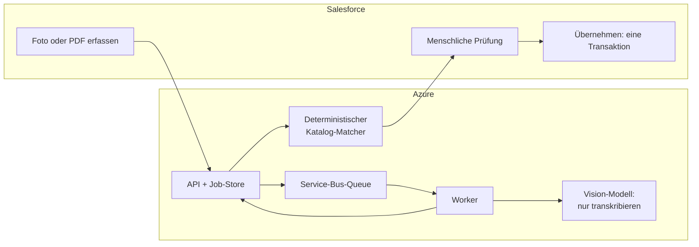

## Das Problem

Außendienstmitarbeitende, die Bars und Restaurants besuchen, wollen erfassen, welche Getränke auf der Karte stehen. Diese Angaben sind die Grundlage für Listungs- und Distributionsentscheidungen im CRM. Dieselben Mitarbeitenden reichen außerdem nach jeder Tour Spesenbelege ein. Beides heißt: ein Dokument von Hand in Salesforce abtippen.

Vision-Language-Modelle können solche Dokumente gut lesen. Aber ein CRM ist kein Ort für Vermutungen. Ein Modell, das einen Produktnamen falsch liest oder eine Zuordnung erfindet, erzeugt fehlerhafte Datensätze, die später jemand finden und bereinigen muss. Die Frage war also nicht „Kann KI eine Getränkekarte lesen?“, sondern „Wie setzen wir KI hier ein, ohne sie etwas entscheiden zu lassen?“

## Schritt 1: erst messen, dann das Modell wählen

Bevor ich irgendetwas gebaut habe, habe ich ein Benchmark-Harness geschrieben, das lokale und gehostete Vision-Modelle mit denselben Eingaben vergleicht. Jeder Lauf wird als reproduzierbares Artefakt gespeichert: Prompts, Rohausgaben, geparstes JSON und Scores.

Auf dem öffentlichen SROIE-Belegdatensatz (347 Dokumente, vier Felder):

| Modell | Feldgenauigkeit | Gültiges JSON | Medianzeit |
| --- | ---: | ---: | ---: |
| Qwen3.6 27B (lokal) | 94,6 % | 100 % | 11,3 s |
| Qwen3-VL 8B (lokal) | 92,9 % | 100 % | 6,2 s |
| Gemini 3.1 Flash Lite (gehostet) | 90,8 % | 100 % | 1,8 s |
| Gemini 2.5 Flash (gehostet) | 90,4 % | 99,7 % | 2,2 s |

Bei 50 deutschen Getränkekarten lagen das beste lokale Modell und ein gehostetes Modell qualitativ gleichauf (kombinierter F1 0,7665 vs. 0,7663). Das lokale Modell brauchte **88 s** pro Dokument, das gehostete **5,7 s**.

Was der Benchmark geklärt hat:

- **Gültiges JSON ist ein gelöstes Problem.** Die verbleibenden Fehler betrafen Feldgrenzen und Normalisierung, nicht fehlerhafte Ausgaben.
- **Raffinierter ist nicht automatisch besser.** Eine Karte in mehrere Ansichten zu zerlegen und die Ergebnisse zusammenzuführen war schlechter und langsamer zugleich (F1 0,59 bei 186 s). Ein OCR-gestützter Prompt war die beste Lösung für die schwierigsten Seiten (F1 0,77).
- **Die Geschwindigkeit entscheidet über die User Experience.** Mit dem Smartphone im Restaurant entscheiden 88 Sekunden Wartezeit darüber, ob das Tool genutzt wird oder nicht.

## Schritt 2: drei klar getrennte Zuständigkeiten

Die Architektur folgt einer Regel: **Das Modell transkribiert, Code ordnet zu, Salesforce schreibt.**

- **Das Modell transkribiert nur.** Es sieht nie Salesforce-IDs und trifft keine fachlichen Entscheidungen.
- **Die Zuordnung ist deterministisch und nachvollziehbar.** Jede extrahierte Zeile wird gegen einen versionierten Snapshot des Produktkatalogs bewertet: 50 % Name, 30 % Tokens, 20 % Marke. Ein Vorschlag gilt nur dann als „wahrscheinlich“, wenn er über einem festen Schwellenwert liegt und einen klaren Vorsprung vor dem Zweitplatzierten hat. Nutzende sehen die drei besten Kandidaten mit den jeweiligen Nachweisen. Schlägt die Zuordnung fehl, bleibt die Extraktion erhalten und kann erneut angestoßen werden. Einen stillen Fallback gibt es nicht.
- **Salesforce verantwortet jeden Schreibvorgang.** Nutzende bestätigen oder verwerfen jede Zeile. Anschließend berechnet der Server eine Vorschau aller Änderungen und signiert sie. Übernommen wird nur, wenn die Vorschau unverändert ist – in einer einzigen Transaktion, die bei jedem Fehler vollständig zurückgerollt wird.

## Gebaut für instabile Mobilfunknetze

Außendienstmitarbeitende arbeiten mit Smartphones und Tablets in Kellern und Bars. Deshalb ist alles asynchron und gefahrlos wiederholbar:

- Die Übermittlung läuft über ein Salesforce-Queueable mit Finalizer. Nutzende sehen sofort „Sie können diesen Bildschirm jetzt verlassen“.
- Jobs, Idempotenzschlüssel und eine Outbox liegen in PostgreSQL. Azure Service Bus stellt die Arbeit mit Leases und einer Dead-Letter-Queue an den Worker zu.
- Ergebnisse kommen per Callback zurück, abgesichert durch Polling und einen zeitgesteuerten Reconciler. Eine verlorene Nachricht verzögert ein Ergebnis, aber es geht nicht verloren.
- Wird dasselbe Dokument zweimal eingereicht, landet es beim selben Job. Wird zweimal übernommen, kommt das erste Ergebnis zurück, statt erneut zu schreiben.

## Die zweite App: Spesenbelege

Die Beleg-App nutzt dasselbe Muster mit einem eigenen Schnittstellenvertrag:

- **Eingabe:** Fotos bis 10 MiB oder das Original-PDF bis 10.000.000 Byte, das unverändert an das Modell geht. Ein Grenzwerttest hat bestätigt, dass genau 10.000.000 Byte akzeptiert und ein Byte mehr abgelehnt werden.
- **Ausgabe:** Summen, eine MwSt.-Übersicht und bis zu 20 Positionen. Summen, Zeilensummen und MwSt.-Rechnung werden im Code mit einer Toleranz von 0,02 EUR geprüft. Unstimmigkeiten werden für die prüfende Person markiert, nie stillschweigend korrigiert.
- **Schwierigster Fall:** Hotelrechnungen, die in Pauschalpreisen verschiedene MwSt.-Sätze mischen. Die Lösung war *Source-Line-Grounding*: Das Modell muss für jede Position die zugrunde liegenden Rechnungszeilen zitieren, bevor es Summen angibt. Diese Nachweise dienen der Prüfung und werden danach aus dem gespeicherten Ergebnis entfernt.
- **Speichern:** eine gesperrte Transaktion pro Beleg, mit einem stabilen Idempotenzschlüssel pro Position.

## Ergebnisse

- **Benchmark:** 94,6 % Feldgenauigkeit bei 347 öffentlichen Belegen. Lokale und gehostete Modelle lagen bei deutschen Getränkekarten nur 0,0002 F1 auseinander, bei der Geschwindigkeit aber um den Faktor 15.
- **Spesen-App:** 8 Tage vom Umsetzungsplan (20. Aug.) bis zur ersten Desktop-Abnahme (28. Aug.). Im Live-Pilot-Benchmark liefen 8 von 8 synthetischen Belegen ohne Nacharbeit durch – bei einer Abnahmeschwelle von 6 von 8.
- **Getränkekarten-App:** Eine dicht befüllte Karte mit 44 Zeilen lief in der Demo-Umgebung durchgängig, ohne dass auch nur eine Nachricht in der Dead-Letter-Queue landete. Im Juli-Benchmark hat der Matcher 500 Katalogkandidaten in 1,44 ms (p95) gerankt.
- **Tests:** 112 Runtime-Tests und 64 gezielte Apex-Tests für das Matching-Release der Getränkekarten-App. 123 Runtime-Tests und 68 gezielte Apex-Tests für die Spesen-App.

## Wie es weitergeht und was ich anders machen würde

Beide Apps laufen im Test in einer Demo-Org. Für den Produktivbetrieb braucht es einen kontrollierten Abnahmelauf in der Ziel-Org und einen Test auf physischen Geräten über die vorgesehenen Smartphones, OS-Versionen und Netze hinweg.

Würde ich neu anfangen, würde ich *zuerst* ein festes Testset aus echten, gelabelten Dokumenten der Zieldomäne aufbauen. Für die Modellwahl waren öffentliche Benchmarks ideal. Die schwierigen Fälle wie deutsche Hotelrechnungen tauchten aber erst in echten Dokumenten auf, und ein festes Set hätte jede spätere Änderung daran messbar gemacht.
