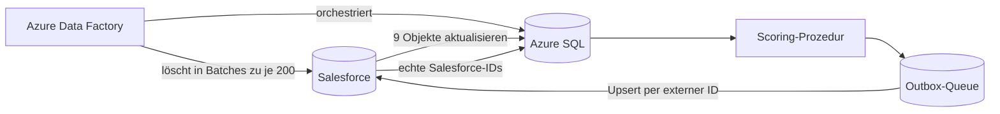

## Das Problem

Wenn Außendienstmitarbeitende einen Markt besuchen, wird der Besuch anhand eines „Perfect Store“-Programms bewertet. Stehen die Fokusprodukte im Regal? Sind die Neuprodukte gelistet? Jede Prüfung bringt je nach erreichtem Schwellenwert Punkte, und die Summe ergibt eine rote, gelbe oder grüne Bewertung für den Besuch und den Account.

Die Prüfungen sind konfigurierbar: Ein Admin definiert jede einzelne als SQL-Abfrage in Salesforce. Die Berechnung muss diese Abfragen also sicher ausführen, jeden offenen Besuch bewerten und die Ergebnisse ohne Duplikate oder verwaiste Datensätze zurück nach Salesforce bringen.

## Architektur

Die Zuständigkeiten sind bewusst getrennt:

- **Azure Data Factory** steuert Reihenfolge, Datenbewegung, Authentifizierung, Wiederholungen und Logging.
- **Azure SQL** wählt die offenen Vorgänge aus, führt die konfigurierten Prüfungen aus, berechnet die Scores und befüllt die ausgehende Queue.
- **Salesforce** liefert Konfiguration und Besuchsdaten und empfängt die Ergebnisse.

## Scoring mit admin-definierten Abfragen

- **Parametrisiert statt verkettet.** Die Abfrage jeder Prüfung nutzt Platzhalter wie `#VisitId#` oder `#SalesOrg#`. Die Prozedur ersetzt sie durch SQL-Parameter und führt die Abfrage über `sp_executesql` aus.
- **Von Schwellenwerten zu Punkten.** Eine Prüfung erhält die Punkte des höchsten Schwellenwerts, den sie erreicht. Gleichstände werden deterministisch aufgelöst, sodass dieselbe Eingabe immer denselben Score ergibt.
- **Eine fehlerhafte Prüfung stoppt nicht den Lauf.** Abfragefehler werden pro Prüfung erfasst. Die übrigen Prüfungen laufen weiter, aber ein Besuch mit Fehler wird nicht als abgeschlossen markiert.
- **Eine Transaktion für die Ergebnisse.** Die Prozedur ersetzt die alten Ergebniszeilen, aktualisiert Score und Bewertung des Besuchs, berechnet den Account anhand seiner letzten abgeschlossenen Bewertung neu, stellt jeden betroffenen Datensatz für den Export in die Queue und committet erst dann.

## Ergebnisse zurück nach Salesforce bringen

Beim Zurückschreiben scheitern Sync-Pipelines meistens. Das waren die Sicherungen:

- **Outbox-Queue.** Die Berechnung schreibt die IDs geänderter Datensätze in eine Queue-Tabelle. Vier Data-Factory-Zweige exportieren Scorings, Scoring-Details, Besuchsjobs und Accounts per externer ID und markieren ihre Queue-Zeilen anschließend als exportiert. Da die Markierung jeweils für einen ganzen Datensatztyp gilt, ist die Pipeline auf einen Lauf gleichzeitig beschränkt.
- **Change Tracking mit Sicherheitsprüfung.** Jeder Export liest seine zuletzt synchronisierte Version. Ist diese älter als die älteste Version, die SQL Server noch vorhält, startet die Pipeline bei dieser ältesten verfügbaren Version, statt abzubrechen.
- **Zwei ID-Welten, sauber abgeglichen.** In SQL erzeugte Datensätze erhalten eine deterministische externe ID wie `<ScoringId>_<JobId>`. Nach dem Upsert holt eine Abgleichs-Pipeline die echten Salesforce-IDs zurück nach SQL.
- **Löschungen, die wirklich löschen.** Überholte Scorings werden in Salesforce über Composite-REST-Aufrufe in Batches zu je 200 IDs entfernt. Die OAuth-Zugangsdaten kommen über eine Managed Identity aus dem Key Vault.
- **Datenbereinigung in Salesforce.** Apex-Batch-Jobs ergänzen fehlende externe IDs, entfernen doppelte Scorings und bereinigen fehlerhafte Detailzeilen.

## Bekannte Grenzen, die ich dokumentiert habe

- Das Watermark für Scorings kann auch dann weiterrücken, wenn die Löschschleife fehlschlägt. Dadurch könnten Löschungen liegen bleiben.
- Ein Lookup in der Löschschleife verwendet noch die externe ID, während die Löschung selbst korrekt die Salesforce-ID nutzt. Beides sollte vereinheitlicht werden.
- Die konfigurierten Prüfungen laufen als dynamisches SQL. Deshalb muss per Review sichergestellt werden, dass sie nur lesend zugreifen. Ein Probelauf der Prozedur allein kann das nicht garantieren.

## Als Nächstes: vom Score zur Empfehlung

Ein Score zeigt Außendienstmitarbeitenden, wo ein Markt steht – aber nicht, was zu tun ist. Deshalb habe ich ein Tool zur Entscheidungsunterstützung konzipiert, das eine Frage beantwortet: *Mit welchen Maßnahmen erreiche ich in der Zeit, die ich für diesen Besuch habe, den nächsten Schwellenwert?*

Weil Punkte nur an Schwellenwerten springen, kann ein unvollständiges Maßnahmenpaket gar nichts bringen. Der Planer geht deshalb so vor:

1. Er leitet pro Schwellenwert die minimal nötigen Maßnahmen ab,
2. kombiniert sie zu einigen wenigen Kandidatenplänen,
3. verifiziert jeden Plan, indem er *dasselbe* Scoring-SQL auf einer isolierten Kopie der Eingabedaten ausführt.

In einem Testbeispiel hoben drei Maßnahmen einen Besuch von 30 auf 50 Punkte; die grüne Bewertung bei 80 war mit den verfügbaren Maßnahmen nicht erreichbar. Der Planer zeigt das vorab, statt den Außendienst das erst nach dem Besuch herausfinden zu lassen. Machine Learning und LLMs bleiben in der ersten Version bewusst außen vor: Die Regeln sind bekannt, also ist exakte Berechnung hier besser als jede Vorhersage.
