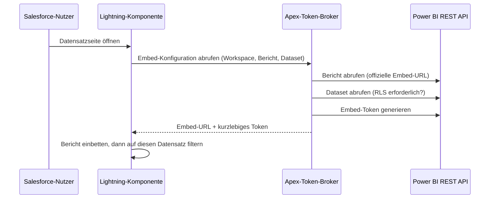

## Das Problem

Die Berichte lagen in Power BI, die Arbeit mit den Kunden fand in Salesforce statt. Die naheliegende Lösung – den Bericht in einen iframe zu packen – scheitert an zwei Stellen:

- **Eine zweite Anmeldung.** Browser blockieren stilles Single Sign-on in iframes, also erscheint mitten in Salesforce eine Microsoft-Anmeldemaske.
- **URL-Filter sind keine Sicherheit.** Ein Filter über die URL steuert, was Nutzende zuerst sehen, nicht, was sie sehen *dürfen*.

Außerdem habe ich SAML-Föderation, den browserbasierten OAuth-Flow in Salesforce und die Anmeldung bei Power BI aus dem Browser heraus ausgeschlossen. Keine dieser Varianten bietet ein Erlebnis ohne zweite Anmeldung bei gleichzeitig serverseitiger Kontrolle.

## Die Lösung: Apex als Token-Broker

Das Muster ist „App Owns Data“ von Power BI. Ein Service Principal in Microsoft Entra ID kommuniziert mit Power BI, und Salesforce verwahrt dessen Zugangsdaten.

- **Lightning Web Component.** Lädt das Power BI JavaScript SDK, bettet den Bericht ein und wendet den Datensatzfilter an, sobald der Bericht geladen ist. Workspace, Bericht und Dataset werden im App Builder festgelegt, sodass Admins die Komponente ohne Codeänderungen für andere Berichte wiederverwenden können.
- **Apex-Controller.** Ruft die Power BI REST API über eine Named Credential auf. Die dahinterliegende External Credential nutzt OAuth Client Credentials gegen die Entra-App-Registrierung.
- **Nur ein kurzlebiges Embed-Token** gelangt überhaupt in den Browser, niemals das Client Secret.

## Row-Level Security: adaptiv und fail-closed

Bevor Apex das Token generiert, liest es die Metadaten des Datasets und baut die Token-Anfrage passend dazu auf:

- **Keine RLS auf dem Dataset:** ein einfaches Token.
- **Identität erforderlich:** Das Token enthält die E-Mail-Adresse der angemeldeten Person als effektive Identität.
- **Zusätzlich Rollen erforderlich:** Apex leitet die Power-BI-Rolle aus der Salesforce-Rolle der Person ab. Lässt sich keine unterstützte Rolle ableiten, **verweigert Apex die Token-Erstellung**, statt uneingeschränkte Daten anzuzeigen.

Apex prüft außerdem, ob das konfigurierte Dataset tatsächlich zum Bericht gehört. Eine falsch konfigurierte Seite kann so keine Daten aus dem falschen Modell anzeigen.

## Probleme, auf die ich gestoßen bin, und die Lösungen

- **„Es funktioniert, dann hört es auf, bis jemand das Secret neu speichert.“** Das Secret war noch gültig. Power BI signalisiert ein abgelaufenes Access Token mit `403`, Salesforce erneuert Tokens standardmäßig aber nur bei `401`. Nachdem `403` in die Token-Refresh-Statuscodes der External Credential aufgenommen war, war das Problem dauerhaft gelöst.
- **`401 Unauthorized` trotz korrektem Setup.** Eine von der falschen Stelle kopierte Workspace-ID verwies auf einen Workspace, den der Service Principal nicht sehen konnte.
- **Ein Deployment-Fehler mit irreführender Ursache.** Öffentliche LWC-Properties dürfen nicht mit `data…` beginnen, deshalb wurde aus `datasetId` `pbiDatasetId`.

## Status und nächster Schritt

Backend, Token-Generierung, Dataset-Prüfungen und Einbettung sind validiert, und der Proof of Concept wurde im Januar 2026 vorgeführt. Offen ist noch das Filtern nach der auf der Seite angezeigten Kundennummer, das noch technische Klärung braucht.

## Was ich mitgenommen habe

**Einen Bericht einzubetten ist einfach. Ihn sicher einzubetten ist Identity-Arbeit.** Der größte Teil des Aufwands floss in Entra, Credentials und das Verhalten der Tokens, nicht in die Komponente selbst. Die Fehlerfälle richtig hinzubekommen war das eigentliche Ergebnis: falsches Dataset, fehlende Rolle, abgelaufenes Token.
