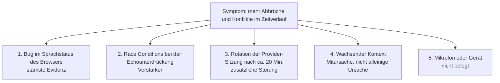

*Dies war ein Teamprojekt. Ich bin zum bestehenden Projektteam dazugekommen und habe zur Untersuchung, zu den Zuverlässigkeits-Fixes und zum unten beschriebenen Test-Tooling beigetragen.*

## Das Problem

Außendienstmitarbeitende sprechen auf dem iPad oder Laptop mit dem Assistenten: „Lege einen Besuch für nächsten Donnerstag um neun mit dem Kunden aus dieser Opportunity an.“ Er durchsucht SAP Sales Cloud, stellt Rückfragen und legt Besuche, Aufgaben und Verknüpfungen an. Der Stack besteht aus einem TypeScript-WebSocket-Backend auf SAP BTP, der OpenAI Realtime API über LiveKit und SAP-Sales-Cloud-Tools per Function Calling.

Das Feedback des Kunden nach zwei Testtagen war unmissverständlich: In längeren Sitzungen kam der Assistent durcheinander. Er fiel den Nutzern ins Wort, verschluckte Gesprächsbeiträge und schlug falsche Datumsangaben vor. Zudem wurden Besuche manchmal mit dem falschen Kunden oder der falschen Opportunity verknüpft.

## Untersuchung: erst die Hypothesen trennen, dann beheben

„Das Modell wird dümmer, je größer der Kontext wird“ ist die naheliegende Erklärung – und sie stimmte nur zum Teil. Wir haben beide Kundensitzungen aus Grafana gezogen, sie von den überlappenden Aktivitäten eines anderen Nutzers getrennt und die Events mit dem Anwendungs- und SDK-Code abgeglichen.

| | Tag 1, erste Sitzung | Tag 1, nach Neuverbindung | Tag 2 |
| --- | ---: | ---: | ---: |
| Abgebrochene Antworten | 24 % | **55 %** | 30 % |
| Kollidierende Antwortanfragen | 1 | **20** | **31** |
| Sprach-Hinweise („Speech Hints“) des Browsers | 23 | **0** | 27, dann keine mehr |

An Tag 2 gab es in den ersten fünf Minuten 3 Abbrüche bei 20 Antworten und keine Konflikte. In den Minuten 15–20 wurden 6 von 14 Antworten abgebrochen, bei 16 Konflikten.

Zwei Beobachtungen widerlegten die einfache Erklärung:

- **Die Sitzung nach der Neuverbindung startete mit frischem Kontext – und war die schlechteste.** Wachsender Kontext konnte also nicht die Hauptursache sein.
- **Der Browser sendete an Tag 2 nach etwa 12 Minuten keine Hinweise „Nutzer spricht“ mehr**, obwohl weiterhin Audio beim Server ankam. Ab diesem Punkt wurde alles schlechter.

Wir haben die Hypothesen nach ihrer Beweislage geordnet:

Außerdem gab es eine Sitzungsrotation. Um Minute 20 schrumpfte die Konversation von 137 auf 113 Einträge und von etwa 24.200 auf 18.100 Input-Tokens. Das passt zur standardmäßigen Lebensdauer der Provider-Verbindung von 20 Minuten im LiveKit SDK, die den Verlauf ohne Function-Call-Einträge neu aufbaut. Die Hinweise waren jedoch schon Minuten vorher ausgeblieben, daher konnte die Rotation die erste Verschlechterung nicht erklären.

## Ursache

Im Browser setzte eine ausreichend lange lokale Stille `isUserSpeaking = false`. Hörte der Server in diesem Moment noch Sprache, übersprang ein Early Return das Zurücksetzen des Flags „Hinweis bereits gesendet“. Der Browser hielt die Äußerung dann für beendet, behielt aber das Flag. Die nächste Äußerung konnte so ohne Hinweis hinausgehen, und die Echounterdrückung des Servers hielt echte Sprache für die eigene Stimme des Assistenten.

Der Fix hält den lokalen Sprechstatus, bis beide Seiten übereinstimmend feststellen, dass der Nutzer aufgehört hat zu sprechen. Status und Hinweis-Flag werden jetzt gemeinsam an einer einzigen akzeptierten Stille-Grenze zurückgesetzt. Bewusst haben wir das Flag *nicht* bei jedem Speech-Stop-Event des Servers zurückgesetzt, weil das bei durchgehendem Sprechen doppelte Hinweise erzeugen würde.

**Validierung:**
- Sechs deterministische Frame-/Event-Tests liefen erfolgreich durch.
- Eine synthetische Reproduktion im Browser (Ton und Stille über einen Mock-Socket, kein echtes Mikrofon) ergab vor dem Fix kumulierte Hinweiszahlen von 1, 1, 2 für drei Äußerungen, danach 3 von 3.

Nebenbei sind wir auf eine Timing-Abweichung gestoßen: Bei 24 kHz und 4.096 Samples pro Chunk dauert jeder Audio-Chunk etwa **171 ms**, während die Code-Kommentare von 85 ms ausgingen. Der Stille-Reset nach „25 Frames“ lag also tatsächlich bei etwa 4,3 Sekunden.

## CRM-Schreibvorgänge vertrauenswürdig machen

Die Fehlersuche im Gesprächsverlauf war die halbe Arbeit. Die andere Hälfte bestand darin, sicherzustellen, dass der Assistent beim Schreiben in SAP auch das Richtige schreibt:

- **Kunde aus dem Deal, nicht aus dem Modell.** Ein Besuch, der aus einer Opportunity heraus angelegt wird, übernimmt Kunde und Ansprechpartner aus dieser Opportunity. Passen die Accounts nicht zusammen, bricht der Vorgang kontrolliert ab, ohne dass etwas geschrieben wird.
- **Typisierte Herkunft von Schreibvorgängen.** Für jede ID wird geprüft, ob sie tatsächlich den Typ hat, den der Assistent angibt. Platzhalter-IDs oder eine Deal-ID, die als Besuchs-ID verwendet wird, werden so abgelehnt, bevor irgendetwas geschrieben wird.
- **Verifikation durch Zurücklesen.** Besuchszeiten und die Verknüpfung zwischen Besuch und Opportunity werden aus SAP zurückgelesen, bevor der Assistent Erfolg meldet.
- **Keine veralteten Schreibvorgänge.** Korrigiert sich der Nutzer mitten im Ablauf, werden Schreibvorgänge auf Basis der überholten Werte blockiert.
- **Schreibweisentolerante, begrenzte Suche.** Die Opportunity-Suche kommt mit Umlaut-Varianten und abweichenden Schreibweisen gesprochener Namen zurecht – mit Limits, statt alles aufzulisten.

## Test-Tooling für lange Sitzungen

Manuelle Sprachtests sind langsam und können keine 40-minütige Sitzung nachstellen. Deshalb haben wir eine interne Evaluierungsumgebung ergänzt:

- **Gescriptete Gespräche.** Jeder Schritt prüft bis zu 11 Event-Typen, vom Transkript bis zum Tool-Ergebnis.
- **Testsuiten für lange Sitzungen.** Sie vergleichen Sitzungen mit geladenem Verlauf und frische Sitzungen, um Effekte eines „langen Gesprächs“ von Effekten „spät in der Sitzung“ zu trennen.
- **Standardmäßig nur lesend.** Schreibvorgänge erfordern eine kurzlebige Freigabedatei: höchstens 30 Freigaben, jede höchstens 45 Minuten gültig und jede auf genau einen Tool-Call mit exakten Argumenten festgelegt.
- **Unabhängiger Nachweis von Schreibvorgängen.** Jeder freigegebene Schreibvorgang wird mit einem separaten SAP-OData-Lesezugriff geprüft. Die Erfolgsmeldung des Tools selbst zählt nie als Nachweis.
- **Strikt intern.** Die Evaluierungsumgebung und der technische Testnutzer, den sie benötigt, sind per Konfiguration dreifach abgesichert und gelangen nie in den Kunden-Branch.

## Ehrlicher Stand

- Der Fix läuft in der internen Umgebung.
- Eine kurze manuelle Sitzung danach verlief sauber: 17 von 17 Antworten wurden vollständig ausgegeben, 8 Tool-Calls waren erfolgreich.
- Das ist ein Smoke-Test, kein Beweis dafür, dass dieser Bug die Vorfälle beim Kunden verursacht hat. Für den Beweis braucht es eine lange, instrumentierte Browser-Sitzung, deren Lifecycle-Events getrennt vom Diagnosepuffer gespeichert werden – denn diesen hatte eine Pause überschrieben.

## Was ich mitgenommen habe

**Die Pipeline messen, nicht nur das Modell.** Das Symptom sah nach einem KI-Problem aus: Verwirrung, falsche Antworten. Die stärkste Ursache war ein kleiner State-Bug in der Audioverarbeitung des Browsers. Dass wir die Hypothesen mit Belegen dafür und dagegen gewichtet haben, hat das Team davor bewahrt, zuerst das Kontextmanagement zu „reparieren“.
