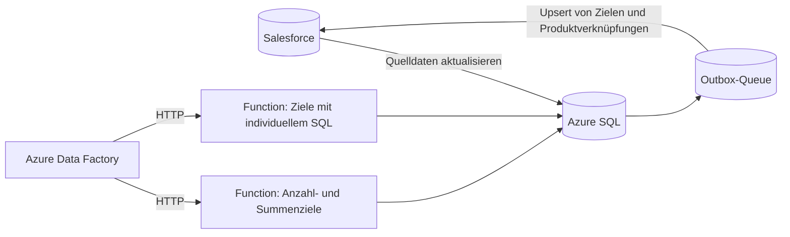

## Das Problem

Für alle Außendienstmitarbeitenden sind in Salesforce Ziele hinterlegt, z. B. eine Anzahl von Marktchecks pro Zeitraum oder Produkte, die distribuiert werden sollen. Den Zielwert legt die Vertriebsleitung fest, der *Ist*-Wert muss jedoch aus abgeschlossenen Besuchen berechnet werden. Das geschah bisher in Legacy-Stored-Procedures, die abgelöst werden mussten.

Es gibt drei Arten von Zielen:

- **Anzahl:** wie viele abgeschlossene Besuchsaufgaben zum Ziel passen.
- **Summe:** die Summe der in diesen Aufgaben erfassten Werte.
- **Individuelles SQL:** eine vom Admin definierte Abfrage, die Werte pro Nutzer und Produkt liefert.

Ziele können außerdem auf bestimmte Produkte beschränkt sein, und Produkte können über *Referenzprodukte* zählen, die nur für einen bestimmten Zeitraum gültig sind. Auch ein Sonderfall musste funktionieren: Wird ein abgeschlossener Besuch wieder geöffnet, geändert und erneut abgeschlossen, müssen seine Werte neu berechnet werden.

## Architektur

1. Data Factory aktualisiert die relevanten Salesforce-Objekte in Azure SQL.
2. Anschließend ruft Data Factory beide Azure Functions parallel auf und wartet, bis **beide** erfolgreich sind, damit der Export immer das kombinierte Ergebnis enthält.
3. Die Functions schreiben ein Detailjournal (jede beitragende Besuchsaufgabe) sowie aggregierte Werte pro Ziel und pro Produkt.
4. Geänderte Datensätze landen in einer Outbox-Queue. Data Factory überträgt sie per Upsert über die externe ID nach Salesforce, markiert die Queue-Zeilen als exportiert und setzt die Change-Tracking-Version weiter.

## Entscheidungen, die es zuverlässig gemacht haben

- **Zuerst die Semantik nachbauen.** Ich habe die Legacy-Stored-Procedures Schritt für Schritt in Python übersetzt, jedes SQL-Statement dokumentiert und die Ergebnisse gegen Beispiele aus dem Fachbereich getestet.
- **Ein Detailjournal, nicht nur Summen.** Jede beitragende Besuchsaufgabe wird mit Ziel, Account, Besuch, Produkt und Datum gespeichert. So lassen sich Summen erklären, und späteres Reporting baut auf denselben Daten auf.
- **Gefahrlos wiederholbar.** Alte Detailzeilen werden per Soft Delete entfernt, bevor neue eingefügt werden, und Ziele werden nur aktualisiert, wenn sich ihr Wert tatsächlich geändert hat.
- **Auf vorübergehende Fehler ausgelegt.** SQL-Aufrufe werden bei Deadlocks, Timeouts und Throttling mit exponentiellem Backoff und Jitter wiederholt. Ein Application Lock (`sp_getapplock`) verhindert, dass sich zwei Durchläufe überschneiden.
- **Keine Secrets im Code.** Die Functions verbinden sich über eine Managed Identity mit Azure SQL. Ein Dry-Run-Modus berechnet alles, ohne zu schreiben.
- **HTTP statt Timer.** Ich habe die Functions von zeitgesteuerten auf HTTP-Trigger umgestellt, damit Data Factory die Reihenfolge der Schritte steuert, und lange Laufzeiten eingeplant, die sonst in Gateway-Timeouts laufen würden.
- **Systemfelder in Ruhe lassen.** Das Zurücksynchronisieren von Salesforce-Audit-Feldern wie `SystemModstamp` ließ den Upsert scheitern, deshalb sendet der Export nur fachliche Felder.

## Reporting auf dieser Basis

Die berechneten Ziele flossen später in eine Faktentabelle in Microsoft Fabric für Power BI. Ein Notebook verknüpft Ziele, Nutzer, Produkte und abgeschlossene Besuche aus dem Silver-Layer und führt sie mit Delta Lake per Merge in eine Gold-Tabelle zusammen. So kann die Vertriebsleitung Ziele und Ist-Werte pro Person im Außendienst und pro Produkt vergleichen.

## Was ich mitgenommen habe

**Wer Logik aus Salesforce herauslöst, beschäftigt sich vor allem mit dem Rückweg.** Die Berechnung selbst war der kleinere Teil. Die meiste Arbeit steckte darin, Hin- und Rückweg vertrauenswürdig zu machen: eine Queue statt „alles exportieren, was sich geändert hat“, immer nur ein Durchlauf gleichzeitig und ein Journal, das jede Zahl erklärt.
