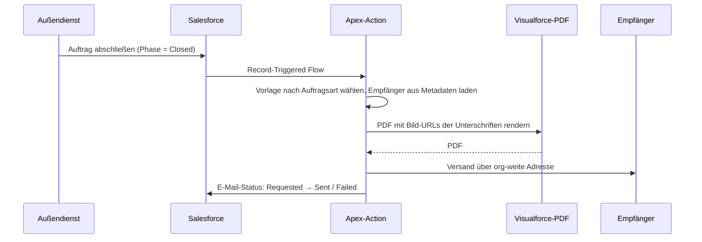

## Das Problem

Außendienstmitarbeitende erfassen Aufträge im Markt (z. B. Möbel und POS-Material) auf einem Tablet, und beide Seiten unterschreiben auf dem Gerät. Danach musste jemand im Büro von Hand eine Bestätigung zusammenstellen. Das Ziel: Wird ein Auftrag abgeschlossen, erzeugt Salesforce ein PDF im Corporate Design mit beiden Unterschriften und sendet es an die passenden Empfänger für diese Auftragsart.

## Die Umsetzung

- **Vorlage pro Auftragsart.** Drei Visualforce-Vorlagen, ausgewählt über das Auftrags-Template.
- **Konfigurierbare Empfänger.** TO, CC und BCC pro Auftragsart liegen in Custom Metadata, sodass Admins sie ohne Deployment ändern können. Ein Debug-Modus schickt alles an eine Testadresse.
- **Nachvollziehbarer Status.** Ein Statusfeld am Auftrag wechselt von `Requested` auf `Sent` oder `Failed`, sodass der Support sehen kann, was passiert ist, ohne Logs lesen zu müssen.
- **Leitplanken.** Ein harter Stopp bei 25 MB vor dem Versand und klare Fehlermeldungen, wenn Kontaktdaten fehlen.

### Das Unterschriftenproblem

Die Visualforce-PDF-Engine von Salesforce kann keine Base64-Bilder rendern – und genau so würde man eine Unterschrift normalerweise einbetten. Ich habe drei Workarounds geprüft und alle verworfen:

1. Eine kostenpflichtige externe PDF-API: zusätzliche Kosten, und Auftragsdaten verlassen die Plattform.
2. Ein selbst gehosteter HTML-zu-PDF-Server: ein weiteres System, das betrieben und abgesichert werden muss.
3. Unterschriften vorübergehend als Static Resources speichern: stößt an Plattformlimits und überlässt das Aufräumen dem Zufall.

Was funktioniert hat: Der Apex-Controller ermittelt für jede Unterschrift die Dateiversion und übergibt der PDF-Engine statt eingebetteter Daten eine dynamische Bild-URL.

## Dann: „sendEmail() war erfolgreich, aber nichts kam an“

Nach dem Go-live erhielten manche Empfänger jede Bestätigung, andere keine einzige. Salesforce meldete jedes Mal Erfolg.

Ich habe das E-Mail-Log gezogen und die Authentifizierungsergebnisse über alle Nachrichten ausgewertet:

- **SPF bestanden:** etwa 10 %
- **DKIM bestanden:** etwa 45 %
- **DKIM-Alignment mit der From-Domain:** etwa **0 %**

Ohne Alignment schlägt DMARC bei fast jeder Nachricht fehl. Viele Microsoft-365-Tenants stellen Mails, die DMARC nicht bestehen, unter Quarantäne oder verwerfen sie stillschweigend. Das erklärte das Muster: Empfänger hinter strengeren Tenants sahen nie etwas, und niemand bekam einen Bounce.

Bei der Analyse tauchte noch eine Falle auf: War der Debug-Modus in den Metadaten aktiviert geblieben, schickte der Code korrekterweise nur an die Debug-Adresse – was genauso aussieht wie ein Zustellungsfehler.

## Der Fix

1. **Absender wechseln.** Mit dem Wechsel auf eine andere verifizierte org-weite E-Mail-Adresse funktionierte die Zustellung bei den betroffenen Empfängern. Ich habe sie sowohl in der Pre-Production- als auch in der Production-Org konfiguriert.
2. **Die eigene Domain des Kunden vorbereiten.** Ich habe das DNS-Ticket für die IT des Kunden geschrieben: die DKIM-CNAME-Records von Salesforce veröffentlichen und Salesforce in den SPF-Record aufnehmen, damit der Schlüssel in Salesforce aktiviert werden kann und E-Mails später von der eigenen Domain des Kunden versendet werden können.
3. **Fehler sichtbar machen.** Durch das E-Mail-Statusfeld an jedem Auftrag wurde aus „Jemand sagt, es sei nichts angekommen“ ein Datensatz, den man prüfen kann.

## Was ich mitgenommen habe

- **Wenn `sendEmail()` Erfolg meldet, heißt das, dass Salesforce die Nachricht angenommen hat – nicht, dass sie jemand erhalten hat.** Zustellbarkeit ist ein DNS- und Identitätsthema und gehört bei jedem Feature, das E-Mails verschickt, auf die Go-live-Checkliste.
- **Wenn „einige Nutzer“ betroffen sind, die Empfängerseite vergleichen.** Der Unterschied lag nicht im Code, sondern darin, hinter welchen Mail-Tenants die Empfänger saßen.
- **Keine org-spezifischen IDs hart codieren.** Die erste Version referenzierte die org-weite Adresse über ihre Record-ID, die sich zwischen Umgebungen unterscheidet. Solche Datensätze besser über einen stabilen Wert nachschlagen.
