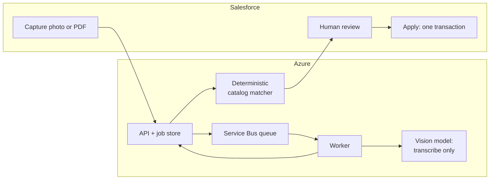

## The problem

Sales reps who visit bars and restaurants want to record which drinks are on the menu. That evidence drives listing and distribution decisions in the CRM. The same reps also file expense receipts after every trip. Both jobs mean typing a document into Salesforce by hand.

Vision-language models can read these documents well. But a CRM isn't a place for guesses. A model that misreads a product name or invents a match creates wrong records that someone has to find and clean up later. So the question wasn't "can AI read a menu?" It was "how do we use AI here without letting it decide anything?"

## Step 1: measure before choosing a model

Before building anything, I wrote a benchmark harness to compare local and hosted vision models on the same inputs. It saves every run as a reproducible artifact: prompts, raw outputs, parsed JSON, and scores.

On the public SROIE receipt set (347 documents, four fields):

| Model | Field accuracy | Valid JSON | Median time |
| --- | ---: | ---: | ---: |
| Qwen3.6 27B (local) | 94.6% | 100% | 11.3 s |
| Qwen3-VL 8B (local) | 92.9% | 100% | 6.2 s |
| Gemini 3.1 Flash Lite (hosted) | 90.8% | 100% | 1.8 s |
| Gemini 2.5 Flash (hosted) | 90.4% | 99.7% | 2.2 s |

On 50 German drinks menus, the best local model and a hosted model tied on quality (combined F1 0.7665 vs 0.7663). The local model took **88 s** per document and the hosted one **5.7 s**.

What the benchmark settled:

- **Valid JSON is a solved problem.** The remaining errors were field boundaries and normalization, not broken output.
- **Clever isn't always better.** Splitting a menu into several views and merging the results was both worse and slower (F1 0.59 at 186 s). An OCR-guided prompt was the best fix on the hardest pages (F1 0.77).
- **Speed decides the user experience.** On a phone in a restaurant, waiting 88 seconds is the difference between using the tool and not using it.

## Step 2: three zones of authority

The architecture follows one rule: **the model transcribes, code matches, Salesforce writes.**

- **The model only transcribes.** It never sees Salesforce IDs and makes no business decisions.
- **Matching is deterministic and explainable.** Each extracted row is scored against a versioned snapshot of the product catalog: 50% name, 30% tokens, 20% brand. A suggestion is "likely" only above a fixed threshold and with a clear lead over the runner-up. The user sees the top three candidates with their evidence. If matching fails, the extraction is kept and can be retried. There's no silent fallback.
- **Salesforce owns every write.** The user confirms or rejects every row. The server then computes a preview of all changes and signs it. Apply only runs if the preview is unchanged, inside one transaction that rolls back completely on any failure.

## Built for flaky mobile networks

Reps work on phones and tablets in basements and bars. So everything is asynchronous and safe to repeat:

- The submission goes through a Salesforce Queueable with a Finalizer. The user sees "safe to leave this screen" right away.
- Jobs, idempotency keys and an outbox live in PostgreSQL. Azure Service Bus delivers work to the worker with leases and a dead-letter queue.
- Results come back through a callback, plus polling and a scheduled reconciler as a safety net. A lost message delays a result but doesn't lose it.
- Submitting the same document twice resolves to the same job, and applying twice returns the first result instead of writing again.

## The second app: expense receipts

The receipt app reuses the same pattern with its own contract:

- **Input:** photos up to 10 MiB, or the original PDF up to 10,000,000 bytes, sent unchanged to the model. A boundary test confirmed that exactly 10,000,000 bytes is accepted and one byte more is rejected.
- **Output:** totals, a VAT summary, and up to 20 line items. Totals, line sums and VAT arithmetic are checked in code with a EUR 0.02 tolerance. Inconsistencies are flagged for the reviewer, never silently corrected.
- **Hardest case:** hotel invoices that mix VAT rates inside package prices. The fix was *source-line grounding*: the model has to quote the invoice lines behind each position before it states totals. That evidence is used for checking and then removed from the stored result.
- **Save:** one locked transaction per receipt, with a stable idempotency key per line item.

## Results

- **Benchmark:** 94.6% field accuracy on 347 public receipts. Local and hosted models were within 0.0002 F1 of each other on German menus, but 15× apart in speed.
- **Expense app:** 8 days from the implementation plan (Aug 20) to first desktop acceptance (Aug 28). In the live pilot benchmark, 8 of 8 synthetic receipts went straight through, against a gate of 6 of 8.
- **Menu app:** a dense 44-row menu ran end to end in the demo environment without a single dead-lettered message. In its July benchmark, the matcher ranked 500 catalog candidates in 1.44 ms (p95).
- **Tests:** 112 runtime tests and 64 focused Apex tests for the menu app's matching release. 123 runtime tests and 68 focused Apex tests for the expense app.

## What's next, and what I'd do differently

Both apps run in test in a demo org. Production needs a controlled acceptance run in the target org and a physical-device test across the intended phones, OS versions and networks.

If I started again, I would build a locked test set of real, labelled documents from the target domain *first*. Public benchmarks were great for choosing a model. But the hard cases, like German hotel invoices, only appeared in real documents, and a fixed set would have made every later change measurable against them.
