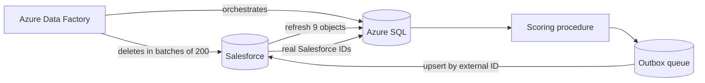

## The problem

When a sales rep visits a store, the visit is scored against a "Perfect Store" program. Are the focus products on the shelf? Are the new products listed? Each check earns points by threshold, and the total becomes a red, yellow, or green rating on the visit and the account.

The checks are configurable: an admin defines each one as a SQL query in Salesforce. So the calculation has to run those queries safely, score every pending visit, and get the results back into Salesforce without duplicates or orphaned records.

## Architecture

The responsibilities are split on purpose:

- **Azure Data Factory** controls order, data movement, authentication, retries, and logging.
- **Azure SQL** selects pending work, runs the configured checks, calculates the scores, and fills the outbound queue.
- **Salesforce** provides the configuration and visit data and receives the results.

## Scoring with admin-defined queries

- **Parameterized, not concatenated.** Each check's query uses placeholders such as `#VisitId#` or `#SalesOrg#`. The procedure replaces them with SQL parameters and runs the query through `sp_executesql`.
- **Thresholds to points.** A check scores the points of the highest threshold it reaches. Ties are broken deterministically, so the same input always gives the same score.
- **One broken check doesn't stop the run.** Query errors are captured per check. The other checks still run, but a visit with an error is not marked complete.
- **One transaction for the results.** The procedure replaces the old result rows, updates the visit's score and rating, recalculates the account from its latest completed scoring, and queues every touched record for export, then commits.

## Getting results back into Salesforce

Writing back is where sync pipelines usually break. These were the safeguards:

- **Outbox queue.** The calculation writes the IDs of changed records into a queue table. Four Data Factory branches export scorings, scoring details, visit jobs, and accounts by external ID, then mark their queue rows as exported. Because the marking applies to a whole record type, the pipeline is limited to one run at a time.
- **Change tracking with a safety check.** Each export reads its last synced version. If that version is older than the oldest version SQL Server still keeps, the pipeline starts from that oldest available version instead of failing.
- **Two ID worlds, reconciled.** Records created in SQL get a deterministic external ID such as `<ScoringId>_<JobId>`. After the upsert, a reconciliation pipeline pulls the real Salesforce IDs back into SQL.
- **Deletes that are actually deletes.** Superseded scorings are removed in Salesforce through composite REST calls in batches of 200 IDs. The OAuth credentials come from Key Vault through a managed identity.
- **Data repair in Salesforce.** Apex batch jobs backfill missing external IDs, remove duplicate scorings, and clean up broken detail rows.

## Known limits I documented

- The watermark for scorings can advance even if the delete loop fails, which could leave deletes behind.
- One lookup in the delete loop still uses the external ID while the delete itself correctly uses the Salesforce ID. These two should be aligned.
- The configured checks run as dynamic SQL, so they must be reviewed to be read-only. A dry run of the procedure can't guarantee that on its own.

## Next: from score to recommendation

A score tells reps where a store stands, not what to do about it. So I designed a decision-support tool that answers: *which actions would reach the next threshold within the time I have for this visit?*

Because points only jump at thresholds, an incomplete set of actions can earn nothing. The planner therefore:

1. derives the minimum actions needed per threshold,
2. combines them into a few candidate plans,
3. verifies each plan by running the *same* scoring SQL on an isolated copy of the input.

In a test example, three actions raised a visit from 30 to 50 points, and the green rating at 80 was out of reach with the available actions. The planner shows that up front instead of letting the rep find out after the visit. Machine learning and LLMs are deliberately left out of the first version: the rules are known, so exact calculation beats prediction here.
