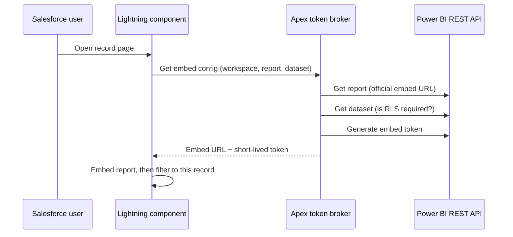

## The problem

Reports lived in Power BI and customer work happened in Salesforce. The obvious solution, putting the report into an iframe, fails in two ways:

- **A second login.** Browsers block silent single sign-on inside iframes, so users get a Microsoft sign-in prompt in the middle of Salesforce.
- **URL filters are not security.** Filtering a report through its URL controls what users see first, not what they're *allowed* to see.

I also ruled out SAML federation, the browser-based OAuth flow in Salesforce, and signing in to Power BI from the browser. None of them gives a "no second login" experience with server-side control.

## The solution: Apex as token broker

The pattern is Power BI's "app owns data". A service principal in Microsoft Entra ID talks to Power BI, and Salesforce keeps its credentials.

- **Lightning Web Component.** Loads the Power BI JavaScript SDK, embeds the report, and applies the record filter after the report has loaded. Workspace, report, and dataset are set in App Builder, so admins can reuse the component for other reports without code changes.
- **Apex controller.** Calls the Power BI REST API through a Named Credential. The External Credential behind it uses OAuth client credentials against the Entra app registration.
- **Only a short-lived embed token** ever reaches the browser, never the client secret.

## Row-level security that adapts and fails closed

Before generating the token, Apex reads the dataset's metadata and builds the token request to match:

- **No RLS on the dataset:** a plain token.
- **Identity required:** the token carries the user's email as effective identity.
- **Roles required too:** Apex derives the Power BI role from the user's Salesforce role. If no supported role can be derived, it **refuses to generate a token** instead of showing unrestricted data.

Apex also checks that the configured dataset really belongs to the report. A misconfigured page can't show data from the wrong model.

## Problems I hit, and the fixes

- **"It works, then stops until someone re-saves the secret."** The secret was still valid. Power BI signals an expired access token with `403`, and Salesforce only refreshes tokens on `401` by default. Adding `403` to the External Credential's token-refresh status codes fixed it for good.
- **`401 Unauthorized` on a valid setup.** A workspace ID copied from the wrong place pointed to a workspace the service principal couldn't see.
- **A deployment error with a misleading cause.** LWC public properties can't start with `data…`, so `datasetId` became `pbiDatasetId`.

## Status and next step

The backend, token generation, dataset checks, and embedding are validated, and the proof of concept was demonstrated in January 2026. The open item is filtering by the customer number shown on the page, which still needs some technical clarification.

## What I took away

**Embedding a report is easy. Embedding it securely is identity work.** Most of the effort went into Entra, credentials, and token behavior, not the component itself. Getting the failure cases right was the real deliverable: wrong dataset, missing role, expired token.
