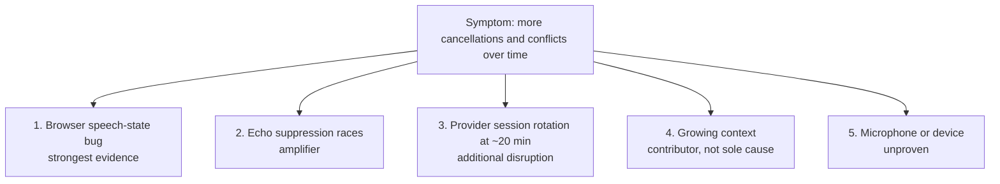

*This was a team project. I joined the existing project team and contributed to the investigation, the reliability fixes, and the test tooling described below.*

## The problem

Sales reps talk to the assistant on an iPad or laptop: "Create a visit for next Thursday at nine with the customer from this opportunity." It searches SAP Sales Cloud, asks follow-up questions, and creates visits, tasks and links. The stack is a TypeScript WebSocket backend on SAP BTP, the OpenAI Realtime API through LiveKit, and SAP Sales Cloud tools via function calling.

The customer's feedback after two test days was blunt: the assistant got confused in longer sessions. It answered over the user, dropped turns, and proposed wrong dates. On top of that, visits were sometimes linked to the wrong customer or opportunity.

## Investigation: separate the hypotheses before fixing anything

"The model gets dumber as the context grows" is the obvious explanation, and it was only partly true. We pulled both customer sessions from Grafana, separated them from another user's overlapping activity, and compared the events with the application and SDK code.

| | Day 1, first session | Day 1, after reconnect | Day 2 |
| --- | ---: | ---: | ---: |
| Cancelled responses | 24% | **55%** | 30% |
| Conflicting response requests | 1 | **20** | **31** |
| Browser speech hints | 23 | **0** | 27, then stopped |

On day 2, the first five minutes had 3 cancellations out of 20 responses and no conflicts. Minutes 15–20 had 6 out of 14 cancelled and 16 conflicts.

Two observations ruled out the simple story:

- **The session after the reconnect started with fresh context and was the worst one.** So context growth couldn't be the main cause.
- **The browser stopped sending "the user is speaking" hints about 12 minutes into day 2**, while audio kept reaching the server. Everything got worse after that point.

We ranked the hypotheses by evidence:

There was also a session rotation. Around minute 20, the conversation dropped from 137 to 113 items and from about 24,200 to 18,100 input tokens. That matches the LiveKit SDK's default 20-minute provider connection lifetime, which rebuilds history without function-call items. But the hints had already stopped minutes earlier, so rotation couldn't explain the first deterioration.

## Root cause

In the browser, a long enough local silence set `isUserSpeaking = false`. If the server still heard speech at that moment, an early return skipped resetting the "hint already sent" flag. The browser then believed the utterance was over but kept the flag. The next utterance could go out without a hint, so the server's echo suppression treated real speech as the assistant's own voice.

The fix keeps the local speaking state until both sides agree that the user stopped. The state and the hint flag now reset together at one accepted silence boundary. We deliberately did *not* reset the flag on every server speech-stop event, because that would create duplicate hints during continuous speech.

**Validation:**
- Six deterministic frame/event tests passed.
- A synthetic browser reproduction (tone and silence over a mock socket, no real microphone) produced cumulative hint counts of 1, 1, 2 for three utterances before the fix, and 3 of 3 after it.

Along the way we found a timing mismatch: at 24 kHz and 4,096 samples per chunk, each audio chunk is about **171 ms**, while code comments assumed 85 ms. So the "25-frame" silence reset was really about 4.3 seconds.

## Making CRM writes trustworthy

Debugging the conversation was half the job. The other half was making sure that when the agent writes to SAP, it writes the right thing:

- **Customer from the deal, not from the model.** A visit created from an opportunity takes its customer and contact from that opportunity. If the accounts don't match, it fails closed with zero writes.
- **Typed write provenance.** Every ID is checked to be the type the assistant claims, so placeholder IDs or a deal ID used as a visit ID are rejected before anything is written.
- **Read-back verification.** Visit times and the visit–opportunity link are read back from SAP before the assistant reports success.
- **No stale writes.** When the user corrects themselves mid-flow, writes based on the outdated values are blocked.
- **Spelling-tolerant, bounded search.** Opportunity search handles umlaut variants and spelling differences in spoken names, with limits instead of listing everything.

## Test tooling for long sessions

Manual voice testing is slow and can't reproduce a 40-minute session. So we added an internal evaluation harness:

- **Scripted conversations.** Each step asserts on up to 11 event types, from transcript to tool result.
- **Long-session suites.** They compare history-loaded and fresh sessions, to separate "long conversation" effects from "late in the session" effects.
- **Read-only by default.** Writes need a short-lived permit file: at most 30 permits, each valid for at most 45 minutes, each naming one exact tool call with exact arguments.
- **Independent proof of writes.** Every authorized write is checked with a separate SAP OData read. The tool's own success message never counts as proof.
- **Strictly internal.** The harness and the technical test user it needs are triple-gated by configuration and never reach the customer branch.

## Honest status

- The fix runs in the internal environment.
- A short manual session afterwards went cleanly: 17 of 17 responses completed and 8 tool calls succeeded.
- That is a smoke test, not proof that this bug caused the customer's incidents. The proof needs a long, instrumented browser session with lifecycle events kept separately from the diagnostic buffer, which a pause had overwritten.

## What I took away

**Measure the pipeline, not just the model.** The symptom looked like an AI problem: confusion, wrong answers. The strongest cause was a small state bug in the browser's audio handling. Ranking the hypotheses with evidence for and against each one kept the team from "fixing" context management first.
