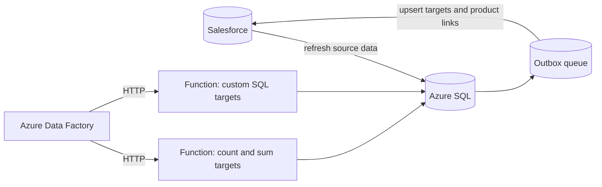

## The problem

Each field rep has targets in Salesforce, for example a number of store checks per period, or products that should be distributed. The target value is set by sales management, but the *actual* value has to be calculated from completed visits. This happened in legacy stored procedures that needed replacing.

Targets come in three kinds:

- **Count:** how many completed visit tasks match the target.
- **Sum:** the sum of values recorded in those tasks.
- **Custom SQL:** an admin-defined query that returns values per user and product.

Targets can also be limited to specific products, and products can count through *reference products* that are only valid for a certain period. One edge case had to work too: when a completed visit is reopened, changed, and completed again, its values must be recalculated.

## Architecture

1. Data Factory refreshes the relevant Salesforce objects into Azure SQL.
2. It calls both Azure Functions in parallel and waits until **both** succeed, so the export always contains the combined result.
3. The functions write a detail ledger (every contributing visit task) plus aggregated values per target and per product.
4. Changed records go into an outbox queue. Data Factory upserts them to Salesforce by external ID, marks the queue rows as exported, and advances the change-tracking version.

## Decisions that made it reliable

- **Rebuild the semantics first.** I translated the legacy stored procedures step by step into Python, documented every SQL statement, and tested the results against examples from the business team.
- **A detail ledger, not just totals.** Each contributing visit task is stored with target, account, visit, product, and date. Totals can be explained, and later reporting builds on the same data.
- **Safe to run again.** Old detail rows are soft-deleted before fresh ones are inserted, and targets are only updated when their value actually changed.
- **Built for transient failures.** SQL calls retry deadlocks, timeouts, and throttling with exponential backoff and jitter. An application lock (`sp_getapplock`) prevents two runs from overlapping.
- **No secrets in code.** The functions connect to Azure SQL with a managed identity. A dry-run mode calculates everything without writing.
- **HTTP instead of a timer.** I switched the functions from scheduled to HTTP triggers, so Data Factory owns the order of steps, and planned for long runs that would otherwise hit gateway timeouts.
- **Leave system fields alone.** Syncing Salesforce audit fields such as `SystemModstamp` back broke the upsert, so the export only sends business fields.

## Reporting on top

The calculated targets later fed a Microsoft Fabric fact table for Power BI. A notebook joins targets, users, products, and completed visits from the Silver layer and merges them into a Gold table with Delta Lake, so sales management can compare targets with actuals per rep and product.

## What I took away

**Moving logic out of Salesforce is mostly about the way back.** The calculation itself was the smaller part. Most of the work went into making the round trip trustworthy: a queue instead of "export everything that changed", one run at a time, and a ledger that explains every number.
