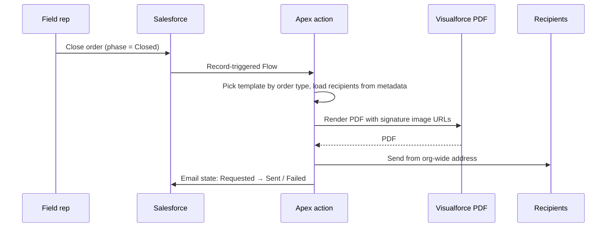

## The problem

Field reps capture in-store orders (for example, furniture and point-of-sale material) on a tablet, and both sides sign on the device. Afterwards, someone in the office had to put together a confirmation by hand. The goal: when an order is closed, Salesforce produces a branded PDF with both signatures and sends it to the right recipients for that order type.

## The build

- **Template per order type.** Three Visualforce templates, chosen by the order template.
- **Configurable recipients.** TO, CC and BCC per order type live in Custom Metadata, so admins change them without a deployment. A debug mode sends everything to a test address.
- **Traceable status.** A state field on the order moves from `Requested` to `Sent` or `Failed`, so support can see what happened without reading logs.
- **Guardrails.** A hard stop at 25 MB before sending, and clear errors when contact data is missing.

### The signature problem

Salesforce's Visualforce PDF engine can't render base64 images, which is how you'd normally embed a signature. I looked at three workarounds and rejected all of them:

1. A paid external PDF API: extra cost, and order data leaves the platform.
2. A self-hosted HTML-to-PDF server: another system to run and secure.
3. Temporarily storing signatures as static resources: hits platform limits and leaves clean-up to chance.

What worked: the Apex controller looks up each signature's file version and passes the PDF engine a dynamic image URL instead of embedded data.

## Then: "sendEmail() succeeded, but nothing arrived"

After go-live, some recipients got every confirmation and others got none. Salesforce reported success every time.

I pulled the email log and computed authentication results across the messages:

- **SPF pass:** about 10%
- **DKIM pass:** about 45%
- **DKIM aligned with the From domain:** about **0%**

Without alignment, DMARC fails for almost every message. Many Microsoft 365 tenants quarantine or silently drop DMARC-failing mail. That explained the pattern: recipients behind stricter tenants never saw anything, and nobody got a bounce.

One more trap turned up during the analysis: with debug mode left on in the metadata, the code correctly sent only to the debug address, which looks exactly like a delivery failure.

## The fix

1. **Switch the sender.** Moving to a different verified org-wide email address made delivery work for the affected recipients. I configured it in both the pre-production and production orgs.
2. **Prepare the client's own domain.** I wrote the DNS ticket for the client's IT: publish Salesforce's DKIM CNAME records and add Salesforce to the SPF record, so the key can be activated in Salesforce and mail can later be sent from the client's own domain.
3. **Make failures visible.** The email state field on each order turned "someone says they didn't get it" into a record that can be checked.

## What I took away

- **`sendEmail()` returning success means Salesforce accepted the message, not that anyone received it.** Deliverability is a DNS and identity problem, and it needs to be part of the go-live checklist for any feature that sends mail.
- **When "some users" are affected, compare the receiving side.** The difference wasn't in the code, but in which mail tenants the recipients were behind.
- **Don't hard-code org-specific IDs.** The first version referenced the org-wide address by record ID, which differs between environments. Look such records up by a stable value instead.
